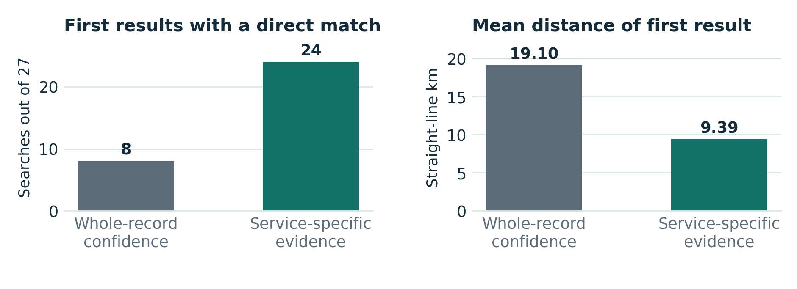
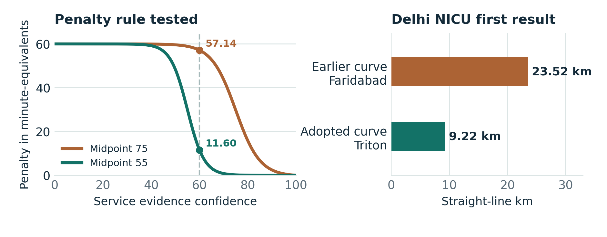
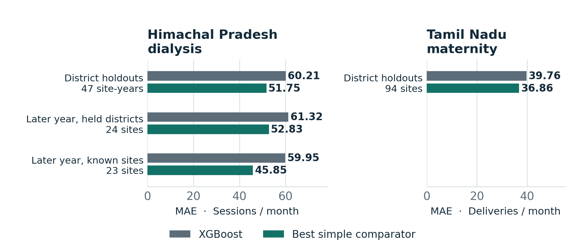
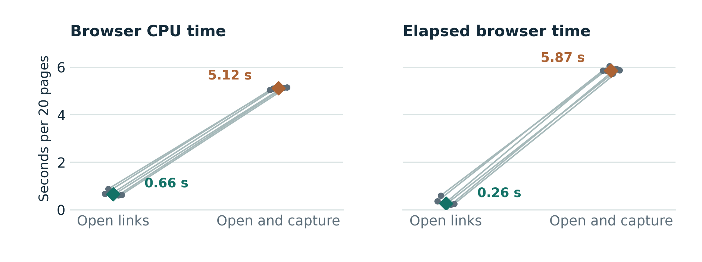
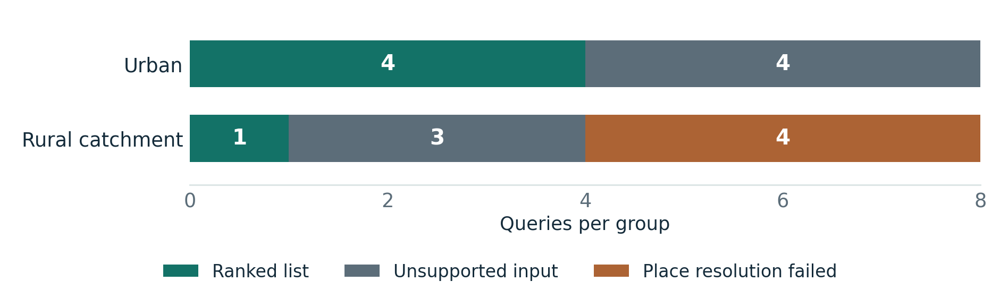
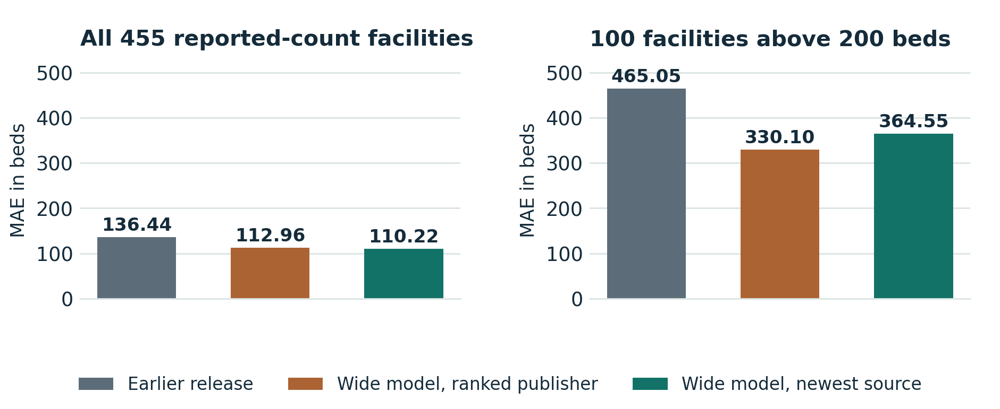

# FINAL PROJECT REPORT: PLEASE READ

*Carnegie Mellon University Datathon · Fall 2026*

**Facility Finder Research Report**

Evidence for healthcare facility recommendations in India

We built Facility Finder to help a community health worker compare branches for a requested service and see the evidence behind each option. The main result came from changing the shortlist with verifiable facts. A branch-specific source made Jaipur dialysis answerable, and a location audit removed a Punjab blood centre that appeared close to Delhi. We also tested how broader text matching, count estimation and optional ranking policies affected that workflow.

The restored app reviewed in this report is pinned to `d682872`. Its map, service-specific confidence and projected-load integration passed local checks. The archived benchmark at 18335aa returned five ranked lists from 16 searches and exposed service and location gaps. Those results describe an earlier app with straight-line travel.

## Project overview

We started by auditing the organizer’s directory and testing whether incomplete facility records could support bed-count estimates. The audit made two separate problems visible. Estimating a missing count required an observed target and a holdout. Recommending a branch required an attributable service and credible coordinates. We built separate pipelines for those tasks and used routing only after the research lookup could identify eligible branches.

Record review changed which data we sought. Government directories helped establish scope and identity. Whole-facility count comparisons needed dated insurer and operator evidence, with unresolved conflicts carried forward as holds. The Hindi keypad prototype and In The Loop addressed different parts of verification. The browser review later gave the existing call prototype a specific role in resolving conflicts. The load work moved from simulated district demand to service-specific projections. The equity study led to a requirement for comparable outcomes and respectful-care evidence.

The first Databricks app connected the cleaned release to a nontechnical search. Replays tested broader service matching and the effect of evidence weights on travel. The frozen benchmark exposed gaps in its menu, origin resolver and service claims. The map was restored on main, and the hypothetical demand slider gave way to an opt-in comparison using published projections. The classic restore then brought the projection option and service-specific scorer into an interface with 18 services, 13 specialty filters and the equity prototype. [Challenge and project history](https://github.com/augustchu/datathon-F26/blob/af89658/possible-next-steps/CONTEXT_AND_HISTORY.md) · [Main decision record](https://github.com/augustchu/datathon-F26/blob/af89658/first-prototype/DECISIONS.md) · [Restored Facility Finder](https://github.com/augustchu/datathon-F26/blob/d682872/first-prototype/MAP_RESTORE.md)

## Report contents

1. [From the prompt to a referral workflow](#1-from-the-prompt-to-a-referral-workflow)
2. [Choosing a service-specific recommendation algorithm](#2-choosing-a-service-specific-recommendation-algorithm)
3. [Why TravelTime entered the app](#3-why-traveltime-entered-the-app)
4. [Research behind confidence, load and equity](#4-research-behind-confidence-load-and-equity)
5. [Data quality recovery and phone verification](#5-data-quality-recovery-and-phone-verification)
6. [Implementation and supplementary verification](#6-implementation-and-supplementary-verification)
7. [Visualizing the recommendation and its evidence](#7-visualizing-the-recommendation-and-its-evidence)
8. [Why projected load and equity are optional](#8-why-projected-load-and-equity-are-optional)
9. [Where the work changed a referral result](#9-where-the-work-changed-a-referral-result)
10. [Benchmark results and mitigation](#10-benchmark-results-and-mitigation)
11. [Next experiments and deployment work](#11-next-experiments-and-deployment-work)
12. [Additional technical evidence](#12-additional-technical-evidence)

## 1 From the prompt to a referral workflow

The challenge asked where a patient should seek a specific service in India and why a health worker should trust the answer. It supplied the Virtue Foundation Foundational Data Refresh (FDR) and asked for a clear, nontechnical workflow on Databricks Free Edition. We treated the answer as a short list of exact branches. A result needed a credible site, evidence for the named service, a comparable trip, and an explanation a health worker could inspect. If the available evidence could support no branch, the search needed to say where it stopped.

Our working unit was a **branch–service claim**, tied to a specific facility, source, scope and date where available. A general surgery listing cannot on its own resolve whether a site provides emergency C-section. A parent organization can publish a capacity total that covers several sites. A visit needs the branch address, while the origin may be a PIN, town, district or coordinate. This separated origin precision, facility identity, service evidence and eligibility from the final order.

The data audit established why that separation mattered. The directory had 10,088 rows and 51 fields. As detailed in Section 5, the content audit accepted far fewer bed counts than the catalog’s non-null tally suggested. The accompanying PIN file describes post offices, and the National Family Health Survey (NFHS-5) reports district survey context. The team kept these units distinct and preserved the source evidence needed to check whether a populated field described the correct branch. The initial random forest and later count experiments therefore supported a specific app decision. When the release supplied an estimate, the app could display it as resource context with its provenance. [Project brief and chronology](https://github.com/augustchu/datathon-F26/blob/af89658/possible-next-steps/CONTEXT_AND_HISTORY.md) · [Directory content audit](https://github.com/augustchu/datathon-F26/blob/af89658/non-ml/DATA_COMPARISON.md) · [Original modeling scope](https://github.com/augustchu/datathon-F26/blob/af89658/ML/capacity_EDA/README.md)

## 2 Choosing a service-specific recommendation algorithm

### Eligibility came before optimization

The research prototype asked whether a site could document the requested service at the branch a person would travel to. Its Confirmed, ML-assisted and Regression-assisted modes shared one service and location gate. The assisted modes filled or estimated selected attributes after that gate. A model-only service suggestion appeared as a lead for research follow-up. A claim had to retain its publisher, branch identity, excerpt and validity. Contradictory claims were held. This approach fit the label supply. An early hand-check yielded seven assertions for three exact branch-service pairs, while the wider evidence inventory classified 6,617 pairs as single-publisher, 4,563 as insufficient, 10 as conflicting and three as corroborated. Treating the unsupported pairs as negative examples would have conflated missing documentation with known absence. [Research prototype and verification policy](https://github.com/augustchu/datathon-F26/blob/af89658/non-ml/PROJECT_SUMMARY.md) · [Quality method](https://github.com/augustchu/datathon-F26/blob/af89658/non-ml/QUALITY_METHOD.md)

The pipeline also tested whether accreditation could add credible evidence. Three dated, scoped profiles from the National Accreditation Board for Hospitals & Healthcare Providers (NABH) could be used. Joining 12,440 unexpired full National Quality Assurance Standards (NQAS) entries yielded zero exact matches to routable branches. Its balanced research mode capped the signal at 5 km or 10 minutes of credit within the same evidence tier, with 60% for independent corroboration and 40% for a current, scoped assessment. The closest ordering omitted the credit, and emergency or trauma remained time-first in that research implementation. That sparse, scope-specific evidence justified a capped credit within the same evidence tier. Accreditation could help decide between documented peers while eligibility still depended on the requested service at the exact branch. The later app uses a separate penalty-based ranking policy. [Quality method and source matching](https://github.com/augustchu/datathon-F26/blob/af89658/non-ml/QUALITY_METHOD.md)

### Why the first app score changed

The initial app relied on a facility-wide documentation score, including identity, contact details, its service inventory and capacity fields. The 10,088-row release had a median score of 10 and a mean of 13.72. Its bands applied 0, 40 or 80 km of penalty. A score could reward unrelated fields and still say little about the particular service. Requiring reviewed branch claims alone would also have left three eligible pairs. The service-specific app admitted explicitly listed services and weak record-level mentions as different evidence classes. The resulting nine-service snapshot contained 8,000 pairs across the menu, 2,447 with a direct match and 5,553 with a passing mention. This expanded the set of visible leads while preserving the distinction the research gate had revealed. [Recommendation decision record](https://github.com/augustchu/datathon-F26/blob/af89658/first-prototype/DECISIONS.md) · [Service-specific ranking change](https://github.com/augustchu/datathon-F26/commit/3cc87f7)

The first comparison held candidates, straight-line distances and demand at zero across 27 routine searches, covering nine services at centroids in Jaipur, New Delhi and Bengaluru. Switching from the facility-wide adjustment to the first service-specific version changed 23 winners and 24 top-three sets. Direct matches rose from eight to 24 winners and the mean winner distance fell from 19.10 to 9.39 km. The comparison measured how the change affected ranking on a fixed cohort. Direct match was classified using the system’s own evidence rules. The replay therefore showed that the old penalty had been driving recommendations away from nearby documentary matches, with clinical correctness still requiring independent labels. [Ranking replay and receipt](https://github.com/augustchu/datathon-F26/tree/af89658/first-prototype/replays/2026-11-22)

**Figure 1.** Fixed ranking replay across 27 city and service queries. Direct-match winners rose from 8 to 24 and their mean straight-line distance fell from 19.10 to 9.39 km.

### What the weight experiments changed

The next tests kept the same 27 searches. Raising a linear evidence cap from five to 15 minute-equivalents changed no winners and three top-three sets. Mean top-three confidence increased from 51.79 to 52.90 and mean distance increased from 19.97 to 20.09 km. An hour-scale piecewise alternative changed three winners, increased mean winner confidence from 59.07 to 61.11 and increased mean winner distance from 9.39 to 10.02 km. In New Delhi NICU, both contenders were direct matches. Faridabad Medical Center at 23.52 km and confidence 95 displaced Triton Hospital at 9.22 km and confidence 60. A first logistic version centered at 75 preserved the piecewise winners, but assigned the confidence-60 listing 57.14 minute-equivalents of penalty. This made an ordinary explicit listing almost as costly as the weakest evidence. [Weight and hour-scale replay records](https://github.com/augustchu/datathon-F26/blob/af89658/first-prototype/DECISIONS.md)

The team retained the 60-minute ceiling and moved the midpoint from 75 to 55, with width narrowed from five to 3.5. The Delhi example showed that the earlier midpoint imposed a near-maximum penalty on an explicit listing and prompted the revised curve. Against the initial logistic curve, the new version changed one winner and five top-three sets. Triton reclaimed first. Mean winner distance moved from 10.02 to 9.49 km and mean winner confidence moved from 61.11 to 59.81. Across the top three, confidence rose from 53.33 to 55.62 and distance rose from 20.21 to 20.98 km. The direct-match count stayed at 24 of 27. The change affected which direct listings and passing mentions moved up or down within the list. The restored map build at `d682872` adopts this curve and its service classifier. Recommended adds travel, a match cost and a confidence cost at every urgency level. The match cost is 5 × (1 − match/100) kilometre-equivalents, doubled in routed minutes. The confidence cost is the curve’s penalty in routed minutes and half that value in kilometre-equivalents. The 2-minute-per-kilometre conversion puts the adjustments on the same scale as the base distance when routes are unavailable. Actual routes use the provider’s estimated travel time. [Current tradeoff and replay](https://github.com/augustchu/datathon-F26/blob/af89658/first-prototype/DECISIONS.md) · [Latest map ranker](https://github.com/augustchu/datathon-F26/blob/d682872/first-prototype/classic_ranking.py)

### Why the revised curve better fits the ranking goal

The practical distinction is between **a branch that explicitly lists the service** and **a record that merely mentions it**. An explicit facility listing with a plausible branch name and PIN earns confidence 60, made up of 50 service points and 10 branch points. A passing mention with the same branch information earns 25. The initial midpoint of 75 placed both on the near-ceiling plateau. Their confidence penalties differed by only 2.86 minute-equivalents. Centering at 55 with a narrower width placed them on opposite sides of the steep transition. The penalty at 60 fell to 11.60, and the penalty at 25 stayed near the ceiling at 59.99. That 48.39-minute-equivalent gap gives an explicit listing more ranking credit over a passing mention. A confidence-50 listing still receives 48.40 minute-equivalents of penalty. An explicit service statement with weak branch identity therefore needs a much shorter trip to compete with a well-attributed statement. The 60-minute ceiling keeps the confidence adjustment bounded. [Penalty comparison and evidence rubric](https://github.com/augustchu/datathon-F26/blob/af89658/first-prototype/DECISIONS.md#confidence-weight-tradeoff)

The revised curve still rewards stronger documentation when the extra trip is modest. At equal service match, confidence 90 can offset about 11.60 additional drive minutes over confidence 60. The earlier logistic curve allowed 54.67 minutes. The 15-minute linear alternative allowed 4.50. A linear rule spreads the penalty evenly across the scale. The revised curve concentrates it around the boundary between weak and explicit evidence and makes small differences among well-documented candidates matter less. The Delhi NICU replay shows how those limits affect a choice. Faridabad Medical Center had stronger evidence at confidence 95 and was 14.30 km farther than Triton. Both had match 100. The earlier penalty difference of 28.23 kilometre-equivalents outweighed that distance gap. The revised difference of 5.80 did not. Triton moved first and Faridabad remained second, so the user could still inspect the better-documented alternative. [Delhi NICU ranking and cost components](https://github.com/augustchu/datathon-F26/blob/af89658/first-prototype/replays/2026-11-22/confidence_logistic55_top_three.csv)

**Figure 2.** Confidence penalty replay across the same 27 queries. For Delhi NICU, the revised curve restored the 9.22 km branch to first place. Both candidates had direct service matches.

The Delhi general-care replay showed the other side of the choice. Amrit Clinic’s passing mention at 3.87 km ranked third with the earlier curve. Dashmesh Hospital explicitly listed the service at 8.75 km and ranked fourth. The revised curve moved Dashmesh up to third and Amrit down to 18th. In the same replay, three searches still returned a passing mention first. The curve changes the ordering of eligible records. The upstream service and branch checks determine which records can compete. [Delhi general-care rankings](https://github.com/augustchu/datathon-F26/blob/af89658/first-prototype/replays/2026-11-22/confidence_logistic55_top_three.csv) · [Frozen replay receipt](https://github.com/augustchu/datathon-F26/blob/af89658/first-prototype/replays/2026-11-22/confidence_logistic55_receipt.json)

The advantage is specific to the app’s intended tradeoff and the replay conditions. Near confidence 55, a one-point change can move the cost by roughly 4.29 minute-equivalents, so evidence classification near that boundary matters. The parameters apply at every urgency level. The routine straight-line replay established how the policy orders candidates. Acceptable travel tradeoffs by urgency, score calibration and clinical outcomes still need independent testing. [Weighting assumptions and remaining tests](https://github.com/augustchu/datathon-F26/blob/af89658/first-prototype/DECISIONS.md#confidence-weight-tradeoff)

## 3 Why TravelTime entered the app

### A route measure fit the use case

Straight-line distance made screening fast and repeatable. The actual decision involves a trip, with route geometry, transport options and reachability. TravelTime’s one-to-many matrix let the project compare candidates from a common origin and arrival context. The research adapter supported driving, walking and cycling, with public transport conditional on provider coverage. Its diagnostics distinguished reachable alternatives, an explicit unreachable response and a missing response. When a selected mode lacked a recommendation, a driving alternative could be offered independently. The matrix can evaluate many branches from one origin in the same query. That made it practical to account for the road network and for reachability without requesting each route separately. Multimodal support also fit the research lookup’s goal of comparing travel options. The project record has a coverage investigation and implementation tests, with no head-to-head vendor accuracy experiment. [Nationwide routing change](https://github.com/augustchu/datathon-F26/commit/227c9b7) · [TravelTime matrix documentation](https://docs.traveltime.com/api/reference/travel-time-distance-matrix-comparison)

### The coverage investigation changed the search

The research adapter initially screened within 50 km, asked for 90-minute journeys and sent up to 100 destinations. The audited New Delhi blood-bank query alone produced 200 eligible branches. A 100-destination cap could therefore omit half of those branches before route ordering. The routing change removed the fixed-radius prefilter and sent the evidence-eligible coordinates in batches of up to 2,000 destinations per request, with a 240-minute route window. The subsequent Databricks diagnostic included Jaipur driving and Gadchiroli driving and walking so analysts could examine an urban case and a rural coverage case with the same runner. Tests validated requests, response handling and fallback. These runs established an interface and exposed coverage as part of the result. The available receipts do not establish live route accuracy for those queries. [Routing change and test contract](https://github.com/augustchu/datathon-F26/commit/227c9b7) · [Databricks route-check entry point](https://github.com/augustchu/datathon-F26/commit/0e487f1) · [New Delhi audit cohort](https://github.com/augustchu/datathon-F26/blob/af89658/non-ml/LOCATION_AUDIT.md)

The restored map build offers estimated drive time, on by default in prepared-snapshot Recommended searches, via a weekday-morning driving-and-ferry matrix with a three-hour search window. Its 30-minute cache is keyed to the origin and candidate records. When estimates are returned, the ranked list uses the reachable destinations and adds evidence costs in minute-equivalents. When estimates cannot be obtained, the interaction shows straight-line distance and uses kilometre-equivalent scoring. The archived recommendation benchmark on commit 18335aa yielded five ranked searches out of 16, with seven unsupported searches and four origin-resolution failures. It was a distance-only replay. Its Jaipur dialysis case surfaced the independently reviewed Soni branch first, while its rural Pithoragarh result was 84.1 km away. The comparison illustrates the need for visible travel units, coverage states and a distance fallback. The fallback keeps the search usable when live estimates fail and labels the distance proxy explicitly. Live routing in the restored build awaits validation. [Classic routing adapter](https://github.com/augustchu/datathon-F26/blob/d682872/first-prototype/traveltime_adapter.py) · [Benchmark protocol](https://github.com/augustchu/datathon-F26/blob/af89658/recommendation-benchmark/README.md)

## 4 Research behind confidence, load and equity

### Confidence describes the strength of a branch-service claim

The app uses separate match and confidence scores. Match is 100 for direct evidence, 40 for a passing mention and zero when evidence is absent or contradictory. Confidence weights the service evidence at 80 for a hospital source with independent corroboration, 75 for one hospital source, 70 for a reviewed directory entry, 50 for an explicit facility-record listing and 15 for a passing mention. Branch identity contributes up to 20 more. The restored classifier looks for negation, future plans, referrals, equipment mentions and references to another location. An SNCU or an unqualified C-section term earns weaker credit than a clear NICU or emergency C-section offer. Creditable evidence supplies a phrase or claim and, where available, its source link. The score orders documentary support for the requested service. Availability and clinical quality require their own evidence. [Evidence points and statuses](https://github.com/augustchu/datathon-F26/blob/d682872/first-prototype/service_confidence.py) · [Latest classic classifier](https://github.com/augustchu/datathon-F26/blob/d682872/first-prototype/classic_confidence.py)

A patient-review pilot tested another quality signal using the same confirmed, balanced, straight-line queries with demand off, once with ordinary review credits and once with credit set to zero. Jaipur and New Delhi dialysis each had one eligible result, Jaipur blood banks had 43 and the narrow Delhi blood-bank search had two. None had an eligible exact-service patient rating, so no ranking changed. A Safdarjung hospital-wide survey reported 70.1% satisfaction from 14,605 responses, but could not identify ratings for the blood centre. Fictional, precisely scoped inputs demonstrated that the bounded credit could reorder two nearby options. The real pilot found neither coverage nor scope sufficient for production review credits. Broadening the Delhi lookup exposed a Faridkot blood centre at an apparent 3.74 km from the Delhi origin. That discovery triggered the location-audit pivot detailed in Section 5. [Patient-review pilot](https://github.com/augustchu/datathon-F26/blob/af89658/non-ml/PATIENT_REVIEW_PILOT.md) · [Location audit and matched replay](https://github.com/augustchu/datathon-F26/blob/af89658/non-ml/LOCATION_AUDIT.md)

### From population scenarios to comparable service loads

The initial demand demo simulated arrivals against generic beds and then introduced a population-share scenario. This answered what could happen under user-specified demand but treated demand and service capacity indirectly. A literature review distinguished staffed throughput, completed activity, scheduled slots and current vacancies. For example, an Ontario simulation of 17,465 hip and knee procedures found that pooling referrals at intake could shift delays to surgery, while pooling at both stages improved 90th-percentile total wait in all five regions studied. The follow-up public data audit recovered no usable confirmed dialysis vacancies for ranking. The narrower comparison uses typical-month caseload grounded in exact branch-service history and modeled throughput in the same unit and modeled period. Source observations can come from different years. The Odisha MRI example uses SCB’s FY2019–20 activity and AIIMS’s FY2025–26 projection. Modeled, observed and unavailable values have separate provenance. [Ontario pooled-referral simulation](https://pmc.ncbi.nlm.nih.gov/articles/PMC12109095/) · [Load-balancing research](https://github.com/augustchu/datathon-F26/blob/af89658/non-ml/LOAD_BALANCING_LITERATURE.md) · [Network caseload methods](https://github.com/augustchu/datathon-F26/blob/af89658/non-ml/caseload/NETWORK_CASELOAD.md)

The forecasting experiments compared XGBoost with baselines built from service-specific predictors on the same splits. For Himachal Pradesh dialysis, 47 site-years across 24 sites gave a monthly MAE of 60.21 sessions with XGBoost versus 51.75 for the machine-scaled median. Holding out districts in the later year yielded 61.32 versus 52.83 on 24 rows. The forward test on 23 known sites yielded 59.95 versus 45.85 for the prior-year activity baseline. On 94 Tamil Nadu maternity sites across 37 districts, XGBoost averaged 39.76 monthly deliveries of error versus 36.86 for a within-type median scaled to comprehensive emergency obstetric and newborn care beds. Adding district population increased error in the matched tests, from 60.21 to 66.09 sessions for dialysis and from 39.76 to 40.19 deliveries for maternity. The lower-error baselines became the preferred estimates when direct reported activity was missing. The nationwide planning table had 181,386 numerical facility-service pairs, with just 38 grounded in exact scoped historical rows at 19 branches. The remaining 181,348 caseload values used peer estimates. The 38 pairs with exact historical activity supplied the app toggle’s branch-service lookup. Even there, modeled throughput lacks a staffing schedule or appointment inventory. [Forecast experiments](https://github.com/augustchu/datathon-F26/blob/af89658/non-ml/caseload/XGBOOST.md) · [Release and scope](https://github.com/augustchu/datathon-F26/blob/af89658/non-ml/caseload/NETWORK_CASELOAD.md)

**Figure 3.** Same-split forecast comparisons. Each simple comparator reduced monthly held-out MAE relative to XGBoost. Dialysis errors are in sessions and maternity errors are in deliveries.

A synchronized-period load replay was too sparse to assess broad impact. On six Himachal Pradesh dialysis origins, one had a comparable alternative and none changed first place. Across 34 non-dialysis origins, none qualified for capacity-adjusted ranking. Fourteen aligned cohorts were too far apart, the nearby Odisha MRI pair lacked comparable throughput and casualty was excluded by policy. The subsequent typical-month planner used historical activity plus modeled throughput estimates to test what a broader scenario could change. Changing the modeled period let the team test the ranking policy on more branches. The earlier synchronized test remains the check with stricter comparability. [Early dialysis replay](https://github.com/augustchu/datathon-F26/blob/af89658/non-ml/LOAD_BALANCING.md) · [Synchronized replay](https://github.com/augustchu/datathon-F26/blob/af89658/non-ml/caseload/CARE_OPTIONS_REPLAY.md)

The retrospective network policy replay kept the same sites and trip distances for the nearest and pressure-aware orders. Of 56 origins, 14 had comparable routine alternatives. Three winners changed, one in Himachal Pradesh dialysis and two in Odisha MRI, with straight-line detours of 0.323, 0.587 and 0.057 km. Eleven comparable winners stayed first, and nine time-critical origins bypassed the comparison. This showed that the policy could alter a decision within a detour rule when suitable data existed. It also quantified how often the policy could even be evaluated on that network. Its outputs were simulated referrals. Arrivals, staffing and actual wait times remain unmeasured. The published projection lookup subsequently replaced the population slider in main and was carried into the restored map build reviewed here. [Network replay](https://github.com/augustchu/datathon-F26/blob/af89658/non-ml/caseload/NETWORK_CASELOAD.md) · [Main projection change](https://github.com/augustchu/datathon-F26/commit/af89658) · [Restored branch integration](https://github.com/augustchu/datathon-F26/commit/781cbcd)

### Why the equity feature remains a demonstration

The feature research first distinguished access and financial protection from the care people receive after arrival. An Odisha assessment of 1,485 patients found Scheduled Tribe respondents were 14 percentage points less likely than people from other social groups to report dignity and respect. A separate 2,639-person survey across 68 Uttar Pradesh public facilities found that reported mistreatment and postpartum complications were associated, with adjusted odds ratio 2.12 and 95% confidence interval 1.67–2.68. The studies motivated a joint measure of clinical outcome and experience. Pooled estimates and differences between patient cohorts could not supply a branch comparison. [Odisha exit survey](https://www.tandfonline.com/doi/pdf/10.1080/23288604.2022.2132366) · [Uttar Pradesh childbirth survey](https://pubmed.ncbi.nlm.nih.gov/28676965/) · [Health equity research](https://github.com/augustchu/datathon-F26/blob/af89658/possible-next-steps/HEALTH_EQUITY_REPORT.md)

The equity research sought both a defined clinical outcome and respectful-care evidence for the same service at the same branch and in comparable cohorts. A seven-site maternity audit found zero qualifying rows. JIPMER recorded 68 stillbirths among 3,280 deliveries. Its separate respect study found 47 of 370 respondents reported disrespect or abuse, with eligibility excluding stillbirth and caesarean deliveries. At Lok Nayak, a cohort of 300 included 35 preterm births and a mean respect score of 64.6 out of 96. It lacked subgroup preterm denominators, and some groups were very small, including eight Scheduled Caste and three Scheduled Tribe patients. The audit changed feature status. The project retained fictional demonstration values and marks a real-data recommendation adjustment unavailable without comparable evidence. The proposed score gives equal weight to risk-adjusted favorable outcomes and respectful-care scores on a 0–100 scale, making the value assigned to each dimension explicit. Requiring the same service and comparable cohorts prevents differences in case mix and survey eligibility from driving a branch comparison. Both measures need scope, methods, denominators and uncertainty. [Maternity data feasibility audit](https://github.com/augustchu/datathon-F26/blob/af89658/possible-next-steps/MATERNITY_OUTCOMES_AUDIT.md) · [Equity decision rules](https://github.com/augustchu/datathon-F26/blob/af89658/possible-next-steps/EQUITY_RANK_FEATURE.md)

## 5 Data quality recovery and phone verification

### Audit the fields that drive decisions

The Virtue Foundation export contained 10,088 rows and 51 fields. The team compared catalog non-null counts with content that could actually supply a model label or route. The catalog listed 9,974 non-null capacity cells and 9,975 non-null doctor-count cells. Parsing values and linking branches yielded 2,509 exact reported bed counts and 3,626 exact doctor counts among 10,073 linked branches. For location, 9,964 source rows had paired coordinates within broad India bounds. That check accepted points that disagreed with their branch addresses. These results established the need to distinguish a populated field, a usable field and a field supported by evidence. The team audited exact counts before fitting and introduced holds for uncertain locations. [Data comparison](https://github.com/augustchu/datathon-F26/blob/af89658/non-ml/DATA_COMPARISON.md)

The first location screen used PIN checks and withheld 499 FDR branches from distance ranking. A public-ratings pilot exposed a case the existing rules missed. The Faridkot listing lacked a PIN and its point near Delhi passed the broad bounds check. After checking the branch license and address, the team added a cited hold and broader checks in d443323. The expanded screen compared the source point with reliable postal references, published state and district, and suspicious points shared across several states. It placed 839 additional holds among 41,489 linked branches in the combined snapshot. The same New Delhi blood-bank search, run before and after the expanded screen, went from 241 eligible branches to 200. Deep Blood Centre, whose license and agreement located it in Faridkot, had been sixth on its erroneous point near Delhi. It became an audit entry without a rank or distance, and a mocked route request confirmed that held points stayed out of the destination list. The team retained the rejected point and its evidence so a reviewer could correct the record without letting the suspect point determine an origin, a route or a rank. [Discovery during the ratings pilot](https://github.com/augustchu/datathon-F26/blob/0cb61fa/non-ml/PATIENT_REVIEW_PILOT.md) · [Location audit and replay](https://github.com/augustchu/datathon-F26/blob/af89658/non-ml/LOCATION_AUDIT.md)

### Change sources when the evidence cannot answer the question

The team collected 31,507 directory and government source rows, including 22,015 NQAS results, 500 from a bounded NABH sample, 6,524 eRaktKosh entries and 2,468 government-program entries. The collection preserved each source’s unit of observation. For example, the blood directory distinguished 4,754 blood banks from 1,770 storage units and included 1,257 zero-coordinate placeholders. The conservative join accepted only 26 FDR links to NQAS, NABH or eRaktKosh records in that version. The larger extracts were still useful for examining directory coverage and for looking up individual claims. The low match yield justified treating each supported branch link as its own piece of evidence. A name, PIN or program membership could guide review. The project only promoted matches with enough evidence to identify the branch and the claim’s scope. [Source coverage and join results](https://github.com/augustchu/datathon-F26/blob/af89658/non-ml/DATA_COMPARISON.md)

The early validation plan used the same fixed samples to check transcription and independent corroboration. Initial browser checks matched six NQAS or NABH records and left three eRaktKosh records unverified. The broad audit stopped after these checks. The later count review prioritized disagreements within a 50-case browser-review cap. Its workbook queued 493 facility–field comparisons and kept 3,265 leads in separate branch-identification tabs. That division put reviewer effort on cases where both the branch and the disputed field could be identified. [Early validation plan](https://github.com/augustchu/datathon-F26/blob/af89658/ACTION_LOG.md#statistical-validation-requested) · [Review budget and worklist](https://github.com/augustchu/datathon-F26/blob/af89658/max-supplemented-data/SUPPLEMENTATION_AND_VERIFICATION_HISTORY.md#4-we-built-the-workbook-and-set-a-review-budget)

A planned comparison of FDR counts against government program extracts stopped when the saved seven-field schema proved to have no whole-facility capacity field. The team changed the acquisition plan to count-bearing sources. A four-source replay used 27,382 IFFCO Tokio, SBI General, Delhi and Kerala rows, linking 696 distinct branches by unique normalized name and PIN. Excluding publishers already cited by the branch’s FDR record left new source candidates for 347 missing bed counts and 270 missing doctor counts. Eligible single-valued reports from 2025 onward covered 93 of those bed fields and 71 doctor fields. Delhi’s approved beds and Kerala’s sanctioned inpatient beds stayed in their reported categories. They measure different things from operational capacity. Among populated FDR bed counts, 121 numeric comparisons agreed and 243 differed. Unknown FDR dates and possible shared hospital submissions limited what those differences could establish. The release pipeline kept source, date, scope and conflicting values in an evidence ledger. A disagreement could indicate different reporting periods, definitions or facilities. Preserving the candidates let a reviewer resolve those possibilities before choosing a training label or supplying an estimate. [External evidence and matching](https://github.com/augustchu/datathon-F26/blob/af89658/data/recovery/capacity-evidence/README.md)

Data review also tested whether a learned rule could select among competing bed reports. Two XGBoost selectors and the publisher fallback each got four of five exact branch-held cases, including all four where the correct value was among the candidates. Each also selected the operator’s value on the two supported independent cases. The two selectors agreed with the fallback on all 194 unresolved cases where a different choice was possible. That evidence led the team to keep publisher ranking as the fallback for those supplements. Later capacity regressions compared how deterministic cleaning rules affected held-out prediction error. Those tests informed the eventual release rule and answered a separate question. [Source selection on frozen cases](https://github.com/augustchu/datathon-F26/blob/af89658/max-supplemented-data/experiments/source_selection/README.md) · [Later capacity experiment](https://github.com/augustchu/datathon-F26/blob/af89658/max-supplemented-data/experiments/capacity/DESCRIPTION_RECOVERY_EVALUATION.md)

### Start with a call pilot at known branches

The browser review left eight of ten branches without a resolved whole-branch bed total. The team proposed using its existing Hindi keypad prototype to follow up on consequential conflicts the browser review could not resolve. The FDR audit found plausible phone formatting on 9,722 of 10,088 source rows, giving the team a substantial list to deduplicate and check for shared switchboards. An offline Hindi keypad prototype already confirms the named branch, asks about specific services, and preserves whether the branch offered the service, plus separate unsure, unanswered and unasked states. A consent step precedes any recording. Count conflicts would go to an administrator follow-up for definition, observation date and a retrievable source. A response is logged as a dated facility self-report. [Desk-review results](https://github.com/augustchu/datathon-F26/blob/af89658/max-supplemented-data/experiments/verification/README.md) · [Hindi IVR runbook](https://github.com/augustchu/datathon-F26/blob/af89658/non-ml/MASS_VERIFICATION.md)

The proposed first wave is 20–30 participating branches. Databricks can prepare the approved worklist and evidence import, with a voice provider and a hosted endpoint handling calls and signed callbacks. Compare the targeted list with a small random list under the same reviewer-time budget. Track connected calls, confirmed branches, answered questions, independently supported facts per hour, and any change to frozen recommendations. The runbook’s historical Plivo scenario estimated ₹9,204 including GST for 10,000 answered two-minute calls. Reachability, completion, labor and costs need measurement before scaling. The recorded experiment tested the flow locally with fictional inputs. [Pilot protocol and planning estimates](https://github.com/augustchu/datathon-F26/blob/af89658/non-ml/MASS_VERIFICATION.md)

## 6 Implementation and supplementary verification

### Publish reviewed evidence for the lookup

The project moved audit and review ahead of the search. The location notebook retains raw addresses, selected points and holds. Service and field notebooks preserve branch IDs, quotations, URLs, validity and recovery decisions. The lookup preparation step compiles service-specific candidates, approximate city, district and postal origins, and cited contacts. Reviewed field recoveries can flow to all three notebook modes, and eligible estimates carry their own provenance. The live query reads the prepared candidates and calculates the trip and ranking preferences for the request. [Notebook responsibilities](https://github.com/augustchu/datathon-F26/blob/af89658/non-ml/README.md) · [Field recovery pipeline](https://github.com/augustchu/datathon-F26/blob/af89658/non-ml/SOURCE_GROUNDED_FIELD_RECOVERY.md)

The recovery pilot compared the same NICU query at PIN 121001 before and after a reviewed operator-page claim. The broader sweep generated 2,421 draft claims, of which 233 belonged to branches on location hold. Two public statements cleared review. They documented NICU and a whole-branch total of 35 beds for Faridabad Medical Center. The branch went from excluded to first in all three modes at the same postal origin and straight-line settings. The team corrected two implementation problems exposed by the pilot. At Arti, a shared footer mentioned dialysis, and the 103-bed statement came from a corporate page with the registered-office address. These failed scope checks caused the team to require the branch anchor in the passage containing the claim. The first replay also exposed conflicting validity labels for an undated claim. They aligned the adapter with the lookup’s existing unknown-validity tier. [Browser evidence for the Arti case](https://github.com/augustchu/datathon-F26/blob/af89658/data/recovery/SAMPLING.md#what-chrome-confirmed) · [Recovery experiment and corrective changes](https://github.com/augustchu/datathon-F26/blob/af89658/non-ml/SOURCE_GROUNDED_FIELD_RECOVERY.md#what-the-pilot-verified)

### Put the curated source into the app

A Databricks preparation notebook reads Marketplace facilities, postal and NFHS inputs, geographic boundaries, and the tracked release CSVs. It reconciles the facility release by stable source IDs, checks original capacities against Marketplace, and associates the companion confidence by release row order. The newest-source release retained 2,713 published capacities, filled 6,833 rows representing 6,829 distinct facilities, and left 542 blanks. The app snapshot carries the capacity status, source, estimate bounds and published contact fields from the release. The stored Delta output is read through SQL at query time. Preparing one versioned snapshot keeps joins and review decisions reproducible. Streamlit reads the reconciled tables through the warehouse and computes travel and user-selected ordering without rerunning Spark or evidence preparation on each search. [Architecture decision](https://github.com/augustchu/datathon-F26/blob/d682872/first-prototype/DECISIONS.md#product-and-architecture) · [Snapshot implementation at d682872](https://github.com/augustchu/datathon-F26/blob/d682872/first-prototype/prepare_snapshot.py) · [Release counts and validation](https://github.com/augustchu/datathon-F26/blob/af89658/max-supplemented-data/experiments/capacity/NEWEST_CAPACITY_RELEASE.md)

The newer Databricks prototype and restored Facility Finder have separate entry points. The restored branch kept the original 18 services, 13 specialty filters and map, then incorporated reviewed service evidence, the published projected-load comparison and service-specific confidence. At d682872, the Databricks Apps manifest starts the classic Streamlit dashboard. The app reads the prepared facility and snapshot metadata tables through a SQL warehouse. The local preview defaults to a labeled synthetic snapshot and supports testing the map without credentials. Recommended ranks eligible results using travel, service match and branch-specific support. The result cards and numbered pins use the same final order. The archived 16-query replay used an earlier main-branch implementation. [Published restore and import decisions](https://github.com/augustchu/datathon-F26/blob/d682872/first-prototype/MAP_RESTORE.md)

### Test whether verification can scale

In The Loop first paired candidate claims with saved screenshots. Reviewers could cross-check scope, date and branch, then export decisions. The desk pilot hid prior labels for 20 candidate claims at ten branches. It yielded two accepted, two rejected and 16 inconclusive rows. Only two branches had an exact comparable operator-published bed count. This was a small, partly targeted sample with one earlier reference case. The unresolved cases gave the existing Hindi IVR prototype a follow-up role in verifying disputed fields. Separately, the team designed a random audit of 130 of 195 eligible branches to estimate branch-level resolution at 95% confidence with an approximate ±5 percentage-point margin. The earlier 50-case threshold would give about ±12 points. The audit remains pending. The link queue paired 161 publisher claims across the 130 branches. It marked 21 branches with disagreements, nine with agreement and 100 with a single insurer. The shared case ID lets a reviewer relate a transcription check to a separate decision about the correct branch count. The published tool later enabled opening exact source passages or PDF pages directly, with screenshots available in the embedded version. [Desk-review design and disposition](https://github.com/augustchu/datathon-F26/blob/af89658/max-supplemented-data/experiments/verification/README.md) · [Direct-link change](https://github.com/yana-157/in-the-loop-verification-tool/commit/dd118e4)

The workflow benchmark asked how much browser effort the screenshot step added. On the same 20 synthetic disclosure pages, the team alternated direct-link opening and link opening plus full-page capture across six paired trials in warmed Chrome. Direct links used median 0.66 seconds of Chrome CPU and 0.26 seconds elapsed. Capturing pages used 5.12 seconds of CPU and 5.87 seconds elapsed and produced 14.5 MB of images. Capture used about 7.8 times the browser CPU. The code history verifies the direct-link change, and the saved benchmark quantifies its compute advantage on this fixture. The record leaves open whether that measurement preceded the switch. Link-only review requires zero model calls, while an accuracy or cost comparison between humans and agents would need frozen cases, independent labels and full review time. [Workflow experiment and limits](https://github.com/augustchu/datathon-F26/blob/af89658/In%20The%20Loop%20Verification%20Tool/REPORT.md) · [Paired trial data](https://github.com/augustchu/datathon-F26/blob/af89658/In%20The%20Loop%20Verification%20Tool/benchmarks/browser-workload.json)

**Figure 4.** Six paired browser trials on 20 synthetic pages per trial. Thin lines join the paired measurements. Diamonds give the median for each workflow.

The scraper audit compared output-first precision checks with independent source-first recall checks. It drew six cases per publisher, field and direction for IFFCO and SBI beds and doctors. All 48 random checks matched, with a 54.1% to 100% exact 95% interval in each six-case cell. A comparison of frame sizes found 6,459 positive IFFCO source doctor cells but 6,458 positive output cells. The targeted 49th check traced this gap to the printed count “04,” which the integer parser had discarded. The parser fix accepted leading zeroes, a concrete change caused by comparing the source and output frames. Copying fidelity, branch linkage and current facility truth remain distinct measurements. [Audit design and omission](https://github.com/augustchu/datathon-F26/blob/af89658/max-supplemented-data/experiments/verification/scraper-audit/README.md) · [Corrected parser](https://github.com/augustchu/datathon-F26/blob/af89658/scripts/extract_iffco_capacity.py)

In The Loop also provides an exact finite-population sampling test for checking emitted claims. The worked example for 161 claims calls for 39 randomly selected rows and at least 38 confirmed correct to support fidelity above 90%, using 98% planning accuracy, a 5% significance level and at least 80% power. This is a sampling plan, with inconclusive judgments visible. The independent source-first comparison remains essential for identifying omissions. [Sampling test and decision rule](https://github.com/augustchu/datathon-F26/blob/af89658/In%20The%20Loop%20Verification%20Tool/README.md#test-scraper-accuracy-with-a-random-sample)

## 7 Visualizing the recommendation and its evidence

The first map interface experimented with an on-screen estimator and then removed it while keeping source-reported beds. The later Databricks demonstration streamlined the search into ranked expanders. Main restored a map for those results. The separate Facility Finder branch recovered the wider classic interface and imported the newer scoring and load code. At the inspected heads, main offered nine services and the restored branch offered 18 services and 13 specialty filters. The map import retained adjustable fit weights, beds and occupancy sorts, and source-reported bed displays. It also recovered a pre-search overview map and used an origin marker even when a search returned no facilities. The split view connects ranked cards to numbered pins and the origin marker. A pin opens directions and a brief facility summary. A card can expose evidence excerpts, website and phone, the basis of the service score, source and capacity caveats, plus a score breakdown. The map updates after the final ordering. Keeping the pin number and card rank synchronized gives the user a way to compare trip and source evidence for the same branch, including when an opt-in choice changes the order. A displaced point can be checked against the branch address before seeking directions. The map restoration established integration and a wider interface. The project has no comparative user study of comprehension or decision time. [Map restoration and branch comparison](https://github.com/augustchu/datathon-F26/blob/d682872/first-prototype/MAP_RESTORE.md) · [Classic map and card implementation](https://github.com/augustchu/datathon-F26/blob/d682872/first-prototype/classic_dashboard.py)

Advanced controls expose travel, evidence, capability, hours, accreditation and rating, record freshness and spare capacity as optional priorities. The rank-order centroid method converts the selected order into weights and shows the component scores. A separate result sort applies those priorities. Recommended, selected priorities and direct travel ordering answer different questions, so the cards display the chosen score and the actual travel measure independently. Clinical benchmark gaps such as the archived Lucknow emergency case, where all five excerpts lacked the exact requested emergency qualifier, make the evidence panel essential. A convincing-looking map conveys location and rank while the excerpt lets a judge or user inspect the basis of the service claim. [Priority ordering implementation](https://github.com/augustchu/datathon-F26/blob/d682872/first-prototype/classic_ranking.py) · [Archived benchmark protocol](https://github.com/augustchu/datathon-F26/blob/18335aa/recommendation-benchmark/README.md)

## 8 Why projected load and equity are optional

Recommended starts with travel, match and evidence. Projected load is an explicit choice within eligible routine Recommended searches. The comparator starts with the first result and looks for nearby branches with the same evidence kind, scope, period and unit. Alternatives are limited to 10 km of additional straight-line distance, and when routed they must also be within 15 added minutes. The ranking comparison gives equal weight to normalized extra travel and projected demand divided by demand plus throughput. Normalizing puts both terms on a common scale. The equal weights and detour caps define the prototype’s tradeoff. The replay varied who ranked first under this policy, and prospective evidence is needed to tune the weights and caps. Load runs before any optional equity adjustment. Without a comparable alternative the app reports that condition and keeps the baseline ordering. This constraint addresses the narrow data coverage and preserves the user’s control over taking a longer trip for an estimate derived from historical activity. [Projected load policy and UI](https://github.com/augustchu/datathon-F26/blob/d682872/first-prototype/projected_load.py) · [Decision and fallback](https://github.com/augustchu/datathon-F26/blob/d682872/first-prototype/classic_dashboard.py)

The equity toggle has a distinct evidentiary hurdle. The proposed adjustment operates among comparable service-evidence peers, outside time-critical searches. The allowance is 1 km of additional straight-line distance. Where comparable route measures exist, added route distance is also limited to 1 km and added travel time to two minutes. The current TravelTime adapter returns route time, so it can use the time bound alongside the straight-line distance bound. The evidence rule requires at least 30 observations for each measure, a prototype threshold whose statistical adequacy depends on the outcome and cohort. An alternative’s lower uncertainty bound must exceed the comparator’s upper bound. The published prototype can demonstrate the rule on synthetic evidence, while searches with no comparable published measures show an unavailable state and preserve the previous order. Its goal is to give patients an explicit choice about whether documented outcomes and respectful care should break a near tie. Neither the load nor equity experiments measured clinical outcomes after a change in ordering. Those outcome gaps and the subjective value of a detour are the reasons to present these as choices, explain any effect on rank, and keep the service and travel evidence in view. [Equity feature and safeguards](https://github.com/augustchu/datathon-F26/blob/af89658/possible-next-steps/EQUITY_RANK_FEATURE.md) · [Equity controls](https://github.com/augustchu/datathon-F26/blob/d682872/first-prototype/dashboard_equity.py)

## 9 Where the work changed a referral result

The strongest app evidence comes from changes we can trace to a specific source or guard. These cases compare an earlier branch decision with the result after review. They show how evidence reaches a user, with a different role for each case.

| Query and starting result | Change after review | Contribution |
| --- | --- | --- |
| Jaipur dialysis. The confirmed lookup initially abstained. | We matched the JLN Marg branch to a hospital dialysis statement and applicable NABH scope. The branch became eligible and later ranked first in the archived app benchmark. | The intervention was exact branch and service corroboration. The app surfaced the evidence used to admit the result. |
| Faridabad NICU. The research lookup excluded the branch. | The operator page supported NICU and separately reported 35 beds. The branch ranked first in all three notebook modes in the fixed PIN replay. | The service claim changed eligibility. The bed count could be shown with its separate provenance. |
| Delhi blood bank. A Faridkot centre appeared sixth from the city origin. | A published Faridkot address triggered a location hold. In the broader coordinate audit, the eligible Delhi set fell from 241 to 200. | A plausible coordinate still needed a branch identity check. Excluding the erroneous point changed the shortlist before routing. |
| Budge Budge capacity. A group disclosure could look like a branch count. | The 103-bed value stayed unresolved for this branch. The team tightened how a passage ties the claim to the exact location. | Abstention and review were visible outcomes. The disputed field did not have to become a confident number. |

In the Jaipur case, candidate links in the directory did not identify which one supported the dialysis excerpt, and many program listings lacked branch coordinates. Using the provider’s branch page and the applicable NABH scope certificate resolved both service attribution and branch identity. In the app, the pin and card then serve different needs. The pin shows the branch position and rank. The card preserves the evidence that explains a result or merits further verification. The underlying release keeps selected counts, estimates and withheld values distinct so a number retains its meaning when it appears on the card. [Jaipur’s original smoke test](https://github.com/augustchu/datathon-F26/blob/af89658/non-ml/PROJECT_SUMMARY.md#evidence-in-hand) · [Branch recovery cases](https://github.com/augustchu/datathon-F26/blob/af89658/non-ml/SOURCE_GROUNDED_FIELD_RECOVERY.md) · [Coordinate audit](https://github.com/augustchu/datathon-F26/blob/af89658/non-ml/LOCATION_AUDIT.md) · [Restored result layout](https://github.com/augustchu/datathon-F26/blob/d682872/first-prototype/MAP_RESTORE.md)

## 10 Benchmark results and mitigation

### Where the recommendation pipeline stopped

We used 16 fixed queries to test the earlier Databricks app at 18335aa. Four were project regression checks and 12 were evidence-panel cases. The panel held eight urban and eight rural-catchment searches. It preserved requested service and mode, asked for up to five results, and ran the pinned preparation and ranker with straight-line travel and zero hypothetical population load. A partial set of documentary reference branches was set aside from the ranker. That allowed the team to distinguish finding a separately supported branch from matching the app’s own evidence labels. We compared urban and rural outcomes and looked for a known reference in the returned lists. The receipt covers one policy, so a paired nearest-eligible baseline remains future work.

**Figure 5.** Urban and rural outcomes on the frozen 16-query run at 18335aa. Both strata contain eight searches. Counts show where coverage failed before the app could return a ranking.
Four urban lists and one rural list returned. The menu or mode stopped five blood-bank requests, one Chennai Level III NICU request and one Mumbai MRI request by public transit. The resolver stopped four rural inputs, Khunti, Keonjhar, Sanchore, and Dantewada, because it lacked an eligible matching facility point. Fifteen cases had a reference branch, of which five produced scored lists. One scored list hit its reference. All 25 displayed cards had a source URL and an excerpt. One had corroborated service evidence, 19 included explicit facility-record listings and five were passing mentions. The other 24 returned branches had no matched reference judgment. The panel therefore identifies specific failures and examples of supported retrieval.

Lucknow exposed the difference between a qualifier and a general procedure. All five excerpts in the emergency C-section query left out the emergency qualifier. Pithoragarh returned a first dialysis result 84.1 straight-line km from the origin and missed the local reference branch. In Jaipur, the sole reference hit appeared first, while the third result carried a Jodhpur label only 5.21 km from the search point. These failures identified requirements for exact service qualifiers, safer branch coordinates, postal place resolution and separate verification of apparent matches after retrieval. The archived scope establishes the requirements. Their effect still needs testing on the restored app. The benchmark predates the final restored interface and documents the earlier app’s behavior. Section 12 gives the frozen query-level receipt. [Benchmark design and judgment rules](https://github.com/augustchu/datathon-F26/blob/18335aa/recommendation-benchmark/README.md)

### What carries forward to the restored app

The current wrapper imports the service-confidence score after the classic keyword selector has found candidates. We compared the explicit main-branch coordinates held by the audit with the tracked release used by the classic app. All **509 of 509 saved branch-point pairs** still matched within 0.000001 degrees and met the classic country bounding-box test. That comparison measures the geographic screen. Whether any branch appears for a specific service still depends on downstream matching and ranking. The stronger main gate and the classic menu therefore need a direct parity test on the same origins and branch evidence.

Local mocked checks of the restored build at `d682872` show that equal-time dialysis choices order by the selected service rubric, a wrong PIN fails to recover a reviewed citation, switching service can remove the prior citation, and map pin order follows list order. The app also has separate projected-load gates on exact branch ID, service, evidence and detour. A version-matched end-to-end run in Databricks with live route responses remains open. [Main coordinate holds](https://github.com/augustchu/datathon-F26/blob/af89658/first-prototype/location_routing_holds.json) · [Classic candidate preparation](https://github.com/augustchu/datathon-F26/blob/d682872/first-prototype/classic_dashboard.py) · [Current score integration](https://github.com/augustchu/datathon-F26/commit/d682872)

### Why the remaining measurement gaps matter

| Gap | Mitigation demonstrated | What remains to establish |
| --- | --- | --- |
| Weak or broad service statements | Exact branch claims and source spans in the research path. The app distinguishes explicit service terms and screens common negations. | Error rates for service subtypes, false passes and unsupported national coverage. |
| Capacity error and missing labels | Audited targets, matched splits, median and forest controls, held cases, preserved provenance and held-out interval calibration. | Accuracy for originally missing values and the tails of the hospital-size distribution. |
| Future availability and equity input | Same-service detour guards, explicit time windows and a paired evidence contract. | Decision-time service slots, risk-adjusted outcome and respect measures and actual referral outcomes. |
| Claim review cost and accuracy | Reproducible source captures, fidelity and recall checks, and direct-link compute measurement. | End-to-end reviewer cost and adjudication accuracy under matched workflows. |

## 11 Next experiments and deployment work

### Reproduce the referral decisions on the current app

Run the restored branch on Databricks Free Edition with a pinned facility snapshot and record route responses, candidate statuses, evidence types and map order. Reuse the 16 fixed inputs and add an independently reviewed set for blood banks versus storage units, Level III NICU and emergency C-section. Test main’s explicit holds against the wrong-location cases and the notebook postal-origin index against the unresolved small towns. Those changes address different failures, so measure their effects separately. On the same inputs, compare nearest eligible, current Recommended and exact-documentation variants. Measure answerability and coverage by stratum, reviewed precision among returned branches, anchor recall, route status, and the additional trip cost created by ranking. For precision, ask an independent reviewer to judge a shuffled pool of results from all compared rankers against the same branch, qualifier, date and excerpt rules. Keep a separate development panel for revising weights so those judgments remain an independent test. [Benchmark protocol](https://github.com/augustchu/datathon-F26/blob/af89658/recommendation-benchmark/README.md) · [Live routing runner](https://github.com/augustchu/datathon-F26/blob/af89658/non-ml/check_traveltime_live.py)

### Evaluate the data work where it will be used

For extraction, the proposed study used 60 development cases and 120 locked cases reviewed independently by two people. Apply the deterministic rules and model-assisted extractors to the same passage. Include missing claims, negation, other branches and competing scope or dates. Score the complete value–branch–scope tuple and whether the quoted span supports it. The proposal includes a 95% observed precision target for accepted claims and a 90% lower confidence bound where sample size supports it. For imputation, freeze estimates and then attempt count verification for a stratified sample of roughly 100–150 branches whose original bed count was blank. Include large and sparsely documented branches. Report verification yield by source and geography and evaluate signed error, absolute error and interval coverage on the verified subset. The historical reported-count holdouts remain a useful reconstruction check.

For verification, compare random, conflict-based and decision-impact queues with a matched review budget. A proposed starting size was about 20 tasks per arm. Measure usable claims per hour, branch confirmation and nonresponse, changes to eligible results and wrongly promoted branches. Advance decision-impact review if it resolves more consequential issues or produces more usable facts per reviewer hour, while maintaining reviewed recommendation accuracy and coverage by stratum. If most conflicts persist, change the source or review method before scaling. Use a separately drawn probability sample for population inference. In The Loop can test human link-only, agent-only and mixed review on the same independently adjudicated claims. The Hindi call pilot can address high-impact fields left unresolved after documentary review. [Field-recovery experiment design](https://github.com/augustchu/datathon-F26/blob/af89658/possible-next-steps/01-source-grounded-field-recovery/README.md) · [Missing-field evaluation proposal](https://github.com/augustchu/datathon-F26/blob/af89658/possible-next-steps/02-validated-missing-field-models/README.md) · [Verification experiment proposal](https://github.com/augustchu/datathon-F26/blob/af89658/possible-next-steps/03-targeted-verification/README.md)

### Validate the optional choices against care outcomes

For scheduled dialysis or MRI, an authorized partner feed could supply exact branch, eligibility, protocol, time zone, timestamp and bookable slot. Compare the nearest eligible option, the current projected load and the earliest confirmed feasible slot. Measure completed care, wait, extra travel and referrals. For equity, use a shared service cohort at partner maternity branches. The proposed paired study uses risk-adjusted 30-day infection after C-section and a private, validated survey of respectful care. It would track case mix, exclusions, follow-up and response rates. Use consented subgroup research with disclosure-reviewed outputs. Show outcome and respect components with uncertainty and test whether their presentation changes an informed choice before adjusting the rank. [Load research and evaluation design](https://github.com/augustchu/datathon-F26/blob/af89658/non-ml/LOAD_BALANCING_LITERATURE.md) · [Equity pilot research](https://github.com/augustchu/datathon-F26/blob/af89658/possible-next-steps/HEALTH_EQUITY_REPORT.md)

## 12 Additional technical evidence

### Capacity experiments used several distinct cohorts

Capacity was an auxiliary prediction target. The team first built a 300-tree forest against a training median, limiting predictors to columns after the source’s `countries` field and excluding the target. Its roughly 80/20 row split kept identical predictor records together. Text encoders were fitted on the training data. Repeated facilities could still cross that split if their records differed, and text available to the model could repeat the reported number. Later comparisons grouped facilities and tested the effect of removing or masking that text. Mean absolute error (MAE) below is in beds. RMSE gives more weight to big misses. [Initial notebook design and limitations](https://github.com/augustchu/datathon-F26/blob/af89658/ML/capacity_EDA/README.md)

#### Test whether district context helps a neural estimator

On 522 branches with original reported counts, the intended comparison used 1,498 training branches and 489 for calibration or early stopping. Two saved neural preprocessors listed 2,013 training rows but lacked branch IDs. Their split could overlap the matched test, so the team refit both architectures before comparing them. The training median scored 150.57 MAE, log-ridge scored 141.94, and the log-random forest scored 141.41. Across three refit seeds, the facilities-only neural network scored 120.27–125.06, averaging 121.9. The NFHS-5 variant scored 128.26–146.24 and lost to facilities-only even on the 315 tests joined to NFHS. Facilities-only won across all three seeds and on the NFHS-matched subset, so it became the neural candidate for testing against newly verified counts at facilities missing a source label. Its 54 largest tests, each at least 500 beds, were still underestimated by roughly 553–599 beds on average across refits. [Facility-held comparison and saved-model audit](https://github.com/augustchu/datathon-F26/blob/af89658/ML/MODEL_EVALUATION.md)

#### Diagnose a failure and change the preprocessing

A separate facilities-only control for the density study scored 3,042.13 MAE on 504 test rows versus 151.11 for the median. One 109-bed facility was predicted at 1,469,024 beds and accounted for 95.8% of the absolute error. A source metadata count of 79.53 exceeded the training range of 0–9. Standardization mapped it to +42.12 and mapped a rare indicator on the same row to −27.46. The test failure directly led to a training-fitted quantile transform bounded at 0–1, with binary flags left at 0 or 1. On the unchanged 504-row replay, the repaired model predicted 11 beds for that case, with overall MAE 126.48 and RMSE 284.89 versus the earlier 65,431.29 RMSE. The replay establishes the numerical fix on the inspected cohort. The proposed density variants still need real density inputs and independent evaluation. [Failure diagnosis and replay](https://github.com/augustchu/datathon-F26/blob/af89658/ML/MODEL_EVALUATION.md#diagnosing-and-replaying-the-outlier) · [Preprocessing change](https://github.com/augustchu/datathon-F26/commit/ec15b98)

#### Test trees, text leakage and recovered labels

The audited tree cohort used 1,311 training, 441 calibration and 467 test branches. Against 156.29 MAE for the training median, the standalone XGBoost forest scored 128.16 and the 24-round boosted forest 123.00. An eight-flag ablation left native numeric missingness in both fits. It returned 123.00 with flags versus 123.14 without, with paired 95% bounds of −1.30 to +1.01 beds. Only three of ten additional seeds favored flags. The near-zero paired difference and the seed comparisons gave the team no basis for requiring eight extra flags. XGBoost already handled numeric missingness in both fits. [Audited XGBoost comparisons](https://github.com/augustchu/datathon-F26/blob/af89658/ML/MODEL_EVALUATION.md#xgboost-forests-with-explicit-missing-predictors)

A wide boosted forest reached 111.78 MAE on the same 467 tests. Masking detected bed-count phrases and removing both phone fields gave 112.25, versus 123.14 for the no-flag core model. Apparent bed wording occurred in 360 test records and an apparent count matched the label in 332. On the 107 tests without detected wording, the masked model still improved on the core, 140.66 versus 148.20. This showed that broader data contained useful signal while exposing plausible leakage and a difference between reported-count and missing-count records. The masked result kept the wider feature set in contention. Because target-like wording and publisher overlap could inflate performance, the later wide fit excluded full descriptions and extracted excerpts. Leakage through other source fields remained possible. [Source-width tests and leakage audit](https://github.com/augustchu/datathon-F26/blob/af89658/ML/MODEL_EVALUATION.md#full-source-width-comparison)

The first source-text pass recovered 12 exact facility totals where the structured field was blank. Nine belonged to training. Of 183 branches with both an extractable description total and a structured count, 180 matched internally. Adding these nine while holding calibration, test and predictor definitions fixed lowered a selected tree fit from 112.80 to 112.35 MAE. Most of 13 model comparisons at the original seed moved by less than one bed. An NFHS neural fit improved by 5.13 beds at seed 42 and worsened at both other seeds. A phone-listing indicator also gave inconsistent results. The manual claims stayed useful for filling particular records. These small and unstable scores support retaining the evidence workflow and give little basis for expanding the model solely on those gains. [Recovered-label and contact experiments](https://github.com/augustchu/datathon-F26/blob/af89658/ML/MODEL_EVALUATION.md#using-counts-recovered-from-descriptions)

### Choose a source before estimating a missing value

The first selection task asked which existing claim to keep among differing publisher values. The targeted review expanded from 36 to 48 cases. Supported exact beds increased from five to seven, and the 20 doctor-count reviews established zero exact totals. The bed selector and publisher fallback each chose four of the seven exact counts. The newest-report rule chose one. The mean candidate Brier score fell from 0.263 to 0.237. The exact choices remained tied, and seven supported references fell below the prespecified minimum of eight. The team therefore gave the exact-choice result and label coverage more weight than the Brier improvement. An independent challenge resolved only two of ten cases, and both saved selectors and the fallback matched both. On 194 unresolved conflicts, the two learned selectors made the same choices as the fallback. Those 194 measure behavior because the correct totals remain unknown. The measured tie and sparse review labels caused the release to retain publisher fallback without a trained selector. The evaluation could not establish a preference between IFFCO and SBI when they disagreed. [Extended source review](https://github.com/augustchu/datathon-F26/blob/af89658/max-supplemented-data/iterations/02-extension.md) · [Selector audit](https://github.com/augustchu/datathon-F26/blob/af89658/max-supplemented-data/experiments/source_selection/README.md)

The next task was numerical imputation. Across six regressors on the same 456 original reported test labels, MAE ranged from 136.49 to 138.18, versus 160.78 for the training median. The provisional export chose the test leader, supplement 01 with NFHS-5 and district population. Its gain over the median was 24.29 beds, with paired 95% bounds of 16.31–32.88. The facilities-only arm led validation and had the lowest test RMSE. Population improved its matching NFHS arm’s test MAE by just 0.10 beds, with the paired interval crossing zero. Removing audit-exposed cases from training had already changed which arm came first. Because the provisional export was chosen on test MAE, its 136.49 is a selection result. The next release selected on validation MAE and continued to hold interval calibration apart from model selection. [Six-arm test design and release limits](https://github.com/augustchu/datathon-F26/blob/af89658/max-supplemented-data/experiments/capacity/RESULTS.md)

### Why the selected release changed and why the blend stayed out

The next comparison evaluated four deterministic source rules across four feature tiers and retained an original-data control. It used 213 validation and 213 interval-calibration branches. Holding Jorhat’s original bed count reduced the previous test set from 456 to 455. Two official sources reported 952 and 964 beds for different observation periods, so the team excluded that disputed target from the matched comparison. The validation-selected configuration was publisher ranking plus district population, at 129.09 validation and 136.44 test MAE. Newest plus NFHS-5 reached 134.99 on test and the original-data control reached 136.41. The 1.44-bed advantage over the selected release had a paired interval spanning zero and a higher RMSE. This lower test point estimate did not change the release. The team used validation to select the model. Publisher ranking and enrichment gave the released counts traceable inputs. Their matched errors did not demonstrate a prediction gain over the original-data control. Published IFFCO and SBI claims were mostly three years apart, so the same-year and two-year averaging rules collapsed to the newest choice. Population was a district total, with no area denominator for density. [Source rule by feature comparisons](https://github.com/augustchu/datathon-F26/blob/af89658/max-supplemented-data/experiments/capacity/RULE_CLEANING_COMPARISON.md) · [Release decision](https://github.com/augustchu/datathon-F26/blob/af89658/max-supplemented-data/experiments/capacity/CAPACITY_MODEL_DECISION.md)

A blend experiment fixed the population feature tier and generated predictions from district-grouped folds. The development-selected fixed blend and feedforward blend scored 136.81 and 136.96 MAE on the same 455 facilities, both above the 136.44 publisher-ranked reference. The paired intervals included zero. The published estimates kept the individual XGBoost model and the optional blended export stayed disabled. A separate factorial replay removed 131 usable disputed bed labels per supplemented arm. The validation winner changed to ranked plus NFHS at 130.58 MAE. Newest plus population led test at 136.59, against 136.72 for the stricter original-data control. District feature gains were small and unstable across eligibility conditions. That experiment supported leaving the existing package in place at that stage. [Feedforward test and disabled candidate export](https://github.com/augustchu/datathon-F26/blob/af89658/max-supplemented-data/experiments/capacity/FEEDFORWARD_EVALUATION.md) · [Disputed-label sensitivity study](https://github.com/augustchu/datathon-F26/blob/af89658/max-supplemented-data/experiments/capacity/SOURCE_FEATURE_FACTORIAL.md)

#### The wider fit supplied the app’s capacity overlay

The final experiment reapplied the four source rules and scanned 9,585 descriptions with tighter scope checks. It recovered 13 service claims and zero new bed or doctor totals. One proposed 200-bed fill referred to a different hospital, and a 16-bed figure described a predecessor in 1911. The source description and extracted excerpts stayed outside the model features. The fit used 1,608 published training labels, 212 validation cases after one disagreement was held, 213 calibration cases and the same 455 reported-count tests. Newest and both averaging variants tied at 112.49 validation and 110.22 test MAE. The wide publisher-ranked arm scored 114.33 and 112.96. The paired test difference was −2.73 beds with a 95% interval from −8.92 to +2.94. Publisher ranking had lower RMSE, 251.30 versus 260.35, and lower MAE above 200 beds, 330.10 versus 364.55 across 100 facilities. The combined recipe improved MAE by 26.21 beds over the earlier 136.44 release, with a paired 95% interval of 15.72–38.00 beds. Features, cleaning and tuning inputs changed together. That comparison supports the full recipe and leaves the isolated effect of description recovery unresolved. [Wide-model W&B results](https://forge.coreweave.com/wandb/yod347-carnegie-mellon-university/datathon-f26/runs/b0360372) · [Fit design and subgroup results](https://github.com/augustchu/datathon-F26/blob/af89658/max-supplemented-data/experiments/capacity/DESCRIPTION_RECOVERY_EVALUATION.md)

**Figure 6.** Absolute bed-count error on matched tests. The newest-source wide model led overall, and the wide publisher-ranked model had lower error above 200 beds.

Validation MAE selected the log-capacity objective, depth five and 111 boosting rounds. Newest and the two averaging rules tied at 112.49 validation MAE, so the release chose newest as the simplest representative. That choice concerns the full imputation pipeline. Individual publisher disagreements still go through direct review and holds. Replaying the archived booster reproduced all 455 saved test predictions. The 10,088-row export retained 2,713 documented values and filled 6,833 rows covering 6,829 facilities. It left 542 blank, comprising 503 branch holds, 26 unresolved reviews, 12 original zeros and one known target defect. Absolute errors from 213 separate calibration branches supplied a 278-bed interval radius. The release adds and subtracts that radius and floors the lower bound at zero. This expresses historical prediction uncertainty on the card. The nominal 90% interval covered 89.9% of the 455 reported test labels and had a median width of 353 beds. For facilities above 200 beds, estimates were 310.41 beds too low on average. Accuracy and coverage on genuinely missing counts still require independent evaluation. The app’s snapshot reads the repository CSV at `max-supplemented-data/capacity_and_confidence/facilities_newest_capacity.csv` and pairs its companion field-confidence CSV before checking IDs back to Marketplace. The spreadsheet-safe download has a protective apostrophe on one ID, and the app copy resolves that strict-join mismatch. [Release contract and archive](https://github.com/augustchu/datathon-F26/blob/af89658/max-supplemented-data/experiments/capacity/NEWEST_CAPACITY_RELEASE.md) · [App snapshot input](https://github.com/augustchu/datathon-F26/blob/d682872/first-prototype/prepare_snapshot.py) · [Tracked CSV correction](https://github.com/augustchu/datathon-F26/commit/7c694a5)

### The frozen query-level benchmark

Each successful search returned five cards. “Reference missed” means that the shortlist omitted the independently supported branch in the partial reference panel. Distances are straight-line kilometres from the approximate search origin. This receipt can be scored with the published evaluator using the pinned queries, reference branches and archived predictions. [Frozen query inputs](https://github.com/augustchu/datathon-F26/blob/18335aa/recommendation-benchmark/queries.json) · [Reference panel](https://github.com/augustchu/datathon-F26/blob/18335aa/recommendation-benchmark/references.json) · [Evaluator](https://github.com/augustchu/datathon-F26/blob/18335aa/recommendation-benchmark/evaluate.py)

| Cohort and origin | Service and requested mode | Result at 18335aa |
| --- | --- | --- |
| Urban · Jaipur | Dialysis · driving | Soni Hospital, 2.85 km · reference at rank 1 |
| Urban · New Delhi | Blood bank · driving | Exact service unavailable in menu |
| Urban · Hyderabad | Cardiac surgery · driving | Aster Prime Hospital, 1.09 km · reference missed |
| Urban · Mumbai | MRI · public transport | Travel mode unsupported |
| Urban · Chennai | Level III NICU · driving | Exact service unavailable in menu |
| Urban · Bengaluru | Blood bank · cycling | Exact service unavailable in menu |
| Urban · Kolkata | Dialysis · driving | Pulse Diagnostics, 1.03 km · reference missed |
| Urban · Lucknow | Emergency C-section · driving | Krishna Medical Centre, 6.00 km · reference missed |
| Rural · Khunti | Dialysis · driving | Origin unresolved |
| Rural · Gadchiroli | Blood bank · walking | Exact service unavailable in menu |
| Rural · Keonjhar | NICU · driving | Origin unresolved |
| Rural · Dindori | Blood bank · driving | Exact service unavailable in menu |
| Rural · Sanchore | MRI · driving | Origin unresolved |
| Rural · Pithoragarh | Dialysis · driving | Pooja Hospital, Najibabad, 84.13 km · reference missed |
| Rural · Churachandpur | Blood bank · public transport | Exact service unavailable in menu |
| Rural · Dantewada | Cardiac surgery · driving | Origin unresolved |
