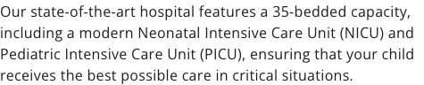

# Public field recovery source checks

On November 21, 2026, we reviewed three exact official pages from two publisher families. These cases were selected to exercise one clear branch claim and two ways an official page can offer insufficient branch evidence. The result is a small diagnostic check. The sample design supplies no population precision estimate or independent corroboration.

## What Chrome confirmed

| Page | Observed evidence and disposition | Live browser evidence |
| --- | --- | --- |
| Faridabad Medical Center homepage | The 35-bed statement describes the facility and includes NICU and PICU in its total. The separate NICU paragraph explicitly describes the facility’s neonatal unit. This same page publishes the facility name and Faridabad PIN 121001 in the footer. The published address matches the prepared branch record at Plot No 458, Sector 21B. Treat capacity and NICU as two separately reviewed publisher claims. | [Bed count and NICU](verification/faridabad-capacity.jpg) · [Branch address](verification/faridabad-address.jpg) · [Official homepage](https://faridabadmedicalcenter.com/home/) |
| Arti Hospital Budge Budge branch page | The visible heading and 539 M. G. Road address identify the Budge Budge branch. The dialysis phrase appears in the common site footer, where it also appears on the corporate About page. Retain the short mention as inspection evidence pending an explicit branch service assertion. | [Branch address](verification/arti-budge-address.jpg) · [Common footer wording](verification/arti-dialysis-listing.jpg) · [Official branch page](https://artihospital.com/site_content/budgebudge_branch) |
| Arti Hospital corporate About page | The page reports 103 beds inclusive of ICU and lists multiple branches in its menu. Its 539 M. G. Road address is labelled the registered office. The short bed statement leaves its publication scope ambiguous. Keep the group claim out of the Budge Budge capacity sidecar. | [103-bed statement](verification/arti-group-capacity.jpg) · [Official About page](https://artihospital.com/site_content/about) |

We also considered Matri Bhavan Hospital. The saved Kolkata facility record uses PIN 700026. The public About page text associates PIN 700076 with the parent mission in the sentence about the hospital. A direct HTTPS certificate check failed, and live Chrome navigation stopped. This source stays outside the frozen recovery documents. [Public About listing](https://www.rksmmatribhavan.org/aboutMatribhavan.php)

The screenshots are cropped live Chrome JPEGs of the exact evidence areas. Address and evidence screenshots can come from separate sections on the same public page. The browser check confirmed the text displayed by each publisher. A staffed service, an available bed, or a clinically appropriate referral requires separate evidence.




## Extraction and snapshot integrity

The [strict page manifest](public_page_manifest.json) pins the URL, CSS selector and exact required text for each excerpt. Beautiful Soup parses the captured HTML, collapses whitespace and copies selected text with its punctuation intact. For the reviewed single-branch Faridabad homepage, `join_with_anchor` places the normalized footer name and location beside the two claim fragments in one saved passage. Newlines mark the fragment boundaries. Each quoted claim remains an exact span of that saved passage. Both claim fragments and the location come from the same page and can be inspected separately in the website’s original layout. The two Arti records keep distinct fragments because their service or capacity scope needs further evidence.

The [frozen document fixtures](public_documents_2026-11-21.json) use three small sets of passages. The raw HTML stays in the private collection cache. This table records the verified HTTPS response hashes used to produce the fixtures.

| Document ID | Bytes | SHA-256 |
| --- | ---: | --- |
| `faridabad-medical-center-home` | 175,906 | `0432453bfad5aa06716d66446838f0906390a5eb77b8ffd7023343282a086ba8` |
| `arti-hospital-budge-budge` | 25,776 | `3c6c24a3d185fb4ba58fbefd2c98e049567a8765548a9b1a023f2d98d53c75f7` |
| `arti-hospital-group-about` | 29,611 | `e452ea73be77213d060fa8abda9c63fe33f2a701820013123bb404e050015aeb` |

The scraper requests only the URLs in the manifest. It uses certificate validation, disables redirects, and bounds response size and time. Each selected node must match its required text exactly once, so drift or a browser challenge interrupts the extraction. The offline mode checks the cached URL, hash and length. A fresh public snapshot has its own retrieval date and requires its own evidence review before release.

From the project root, pass a private cache directory and output file names. The scraper uses `requests` and `beautifulsoup4` from the existing [source collection dependencies](../../scripts/requirements_government_sources.txt).

```sh
snapshot_dir=$(mktemp -d)
python3 scripts/scrape_field_recovery.py \
  --fetch --retrieved-on YYYY-MM-DD \
  --cache-dir "$snapshot_dir/raw" \
  --documents "$snapshot_dir/documents.json" \
  --audit "$snapshot_dir/source-audit.json"
```

To replay the snapshot, rerun the command with the same paths and omit `--fetch` and `--retrieved-on`. The [recovery notebook](../../non-ml/notebooks/04a_source_recovery.ipynb) consumes the selected documents as an offline input. It applies its own branch matching and claim review rules before preparing sidecars.

To replay the reviewed example on the matching prepared facility snapshot, set `DATATHON_RECOVERY_DOCUMENTS` to `data/recovery/public_documents_2026-11-21.json` and `DATATHON_RECOVERY_REVIEWS` to `data/recovery/public_reviews_2026-11-21.json`. The approvals bind the two exact Faridabad claim IDs. A fresh capture may produce new IDs and require a new review.
