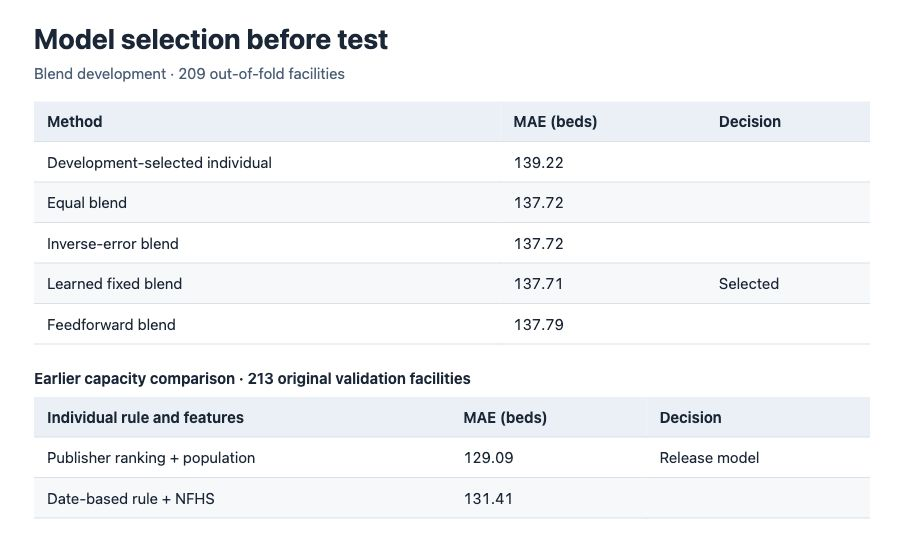
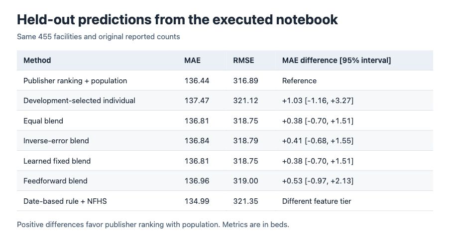
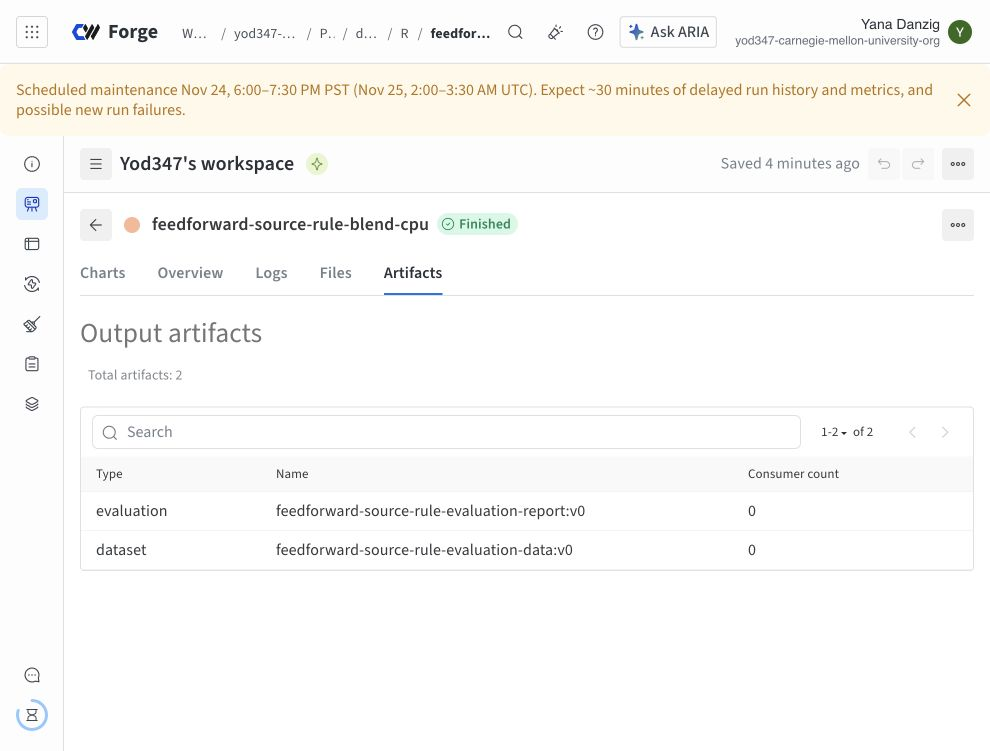

# Bed-capacity model decision

The follow-up independently refit the source rules and feature blocks, including a stricter pass that excluded disputed bed counts. [Fresh comparison and updated decision](SOURCE_FEATURE_FACTORIAL.md)

**Use the publisher-ranked source rule with district population for the release dataset.** This is `iteration_01__population`, the XGBoost model that supplied estimates for 6,829 facilities with eligible missing bed counts. It led the original validation comparison and had lower test error than every blend evaluated with the same features. The date-based rule with NFHS socioeconomic features had the lowest observed test MAE across the earlier full comparison. Its result is worth testing again on a fresh set of facilities with verified counts. [Source-rule comparison](RULE_CLEANING_COMPARISON.md) · [Executed blend evaluation](FEEDFORWARD_EVALUATION.md)

## What we chose

The fixed rule selects the highest-ranked eligible count source when several claims remain. The stored order for this experiment was FDR, IFFCO and SBI, based on agreement in the earlier review sample. Recency breaks ranking ties. A direct review or an unresolved field hold takes precedence. The eligibility checks preserve branch matching and whole-facility scope. After cleaning, XGBoost uses facility attributes and district population totals to estimate missing bed counts. The source rule is deterministic and the predictor is fitted. The learned fixed **blend** was a separate candidate that averaged model predictions with the same weights at every facility. [Source selection and evidence rules](RULE_CLEANING_COMPARISON.md#3-compare-four-deterministic-source-rules)

## Why the test winner did not become the release model

We chose the release configuration on 213 validation facilities before reading the historical test scores. Publisher ranking plus population averaged **129.09 beds** of error there. The date-based rule plus NFHS socioeconomic features averaged **131.41**. The chart also shows the separate selection of the learned fixed blend, which used 209 development facilities drawn from out-of-fold predictions in the original training partition.

On the 455 test facilities the ordering reversed by MAE. The date-based model plus NFHS averaged **134.99 beds** of error versus **136.44** for publisher ranking plus population. That is **1.44 beds better on this sample**. The paired 95% interval runs from **4.85 beds better to 2.07 beds worse**, so this sample does not establish which would have lower MAE on new facilities. The date-based model also had higher test RMSE, **321.35 versus 316.89**, which indicates larger misses under a metric that emphasizes them. This comparison changes both the source rule and the district feature block, so it cannot isolate which change produced the difference.

Validation determined the release. The test comparison measured how the already-chosen model performed on facilities outside that decision. Picking a replacement after reading these test scores would turn this test into another model-selection set. A new, independently verified holdout could settle which of the two configurations generalizes better. [Full score table and paired intervals](RULE_CLEANING_COMPARISON.md#4-fit-and-score-the-16-cleaned-datasets-and-original-data-control)

## What the feedforward run added

We froze the population feature tier so the source-rule comparison held the features constant. Five district-grouped folds gave the blend 1,284 out-of-fold predictions. The three date-based cleaning rules supplied identical input and predictions on this dataset. They counted as one signal, alongside publisher ranking. The development-selected fixed blend gave approximately half its weight to each signal. The feedforward network could change the weights by facility. Both were compared with exactly the same 455 prior test facility IDs and reported labels. [Fit and comparison details](FEEDFORWARD_EVALUATION.md#what-ran-on-november-21-2026)

The fixed blend averaged **136.81 beds** of error and the feedforward blend averaged **136.96**, compared with **136.44** for publisher ranking using the same features. The fixed blend was 0.38 beds worse, with a paired 95% interval from −0.70 to +1.51. The feedforward blend was 0.53 beds worse, with an interval from −0.97 to +2.13. Both intervals include zero. The blend experiment provides no evidence that additional model complexity improves bed-count predictions on this test set.

## What the release can support

Each estimate travels with provenance and an interval. The selected model had **90.5%** coverage for its nominal 90% interval on reported test counts, with a median width of **459 beds**. At facilities with more than 200 reported beds, its MAE was **465.05 beds**, its average error was **−444.87 beds**, and interval coverage was **58%**. Those estimates need particular care if used for load distribution. Occupied beds and current service availability require their own evidence. The original FDR control scored 136.41 test MAE and 313.21 RMSE. The main measured benefit of the cleaning workflow is traceable source evidence and explicit holds. This evaluation did not establish an accuracy gain over the original-data control. [Capacity release and pipeline handoff](RULE_CLEANING_COMPARISON.md#5-workbook-verification-and-pipeline-handoff)

## Audit trail

The CPU notebook run finished locally in 3.44 seconds. The W&B run contains its results, full run report and a private data artifact with the exact feature snapshot, frozen model files, 455 evaluation rows and executable notebook. The run package reproduced the held-out predictions and metrics exactly when replayed from a fresh directory. The first two screenshots render archived run outputs. The final screenshot shows the two artifacts in W&B. [W&B run](https://forge.coreweave.com/wandb/yod347-carnegie-mellon-university/datathon-f26/runs/a6617f37) · [Data artifact](https://forge.coreweave.com/wandb/yod347-carnegie-mellon-university/datathon-f26/artifacts/dataset/feedforward-source-rule-evaluation-data/v0) · [Evaluation artifact](https://forge.coreweave.com/wandb/yod347-carnegie-mellon-university/datathon-f26/artifacts/evaluation/feedforward-source-rule-evaluation-report/v0)

