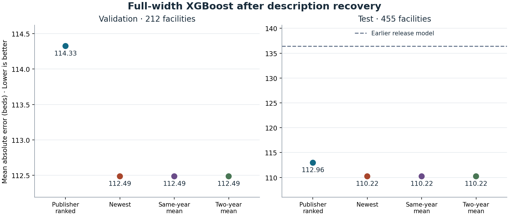
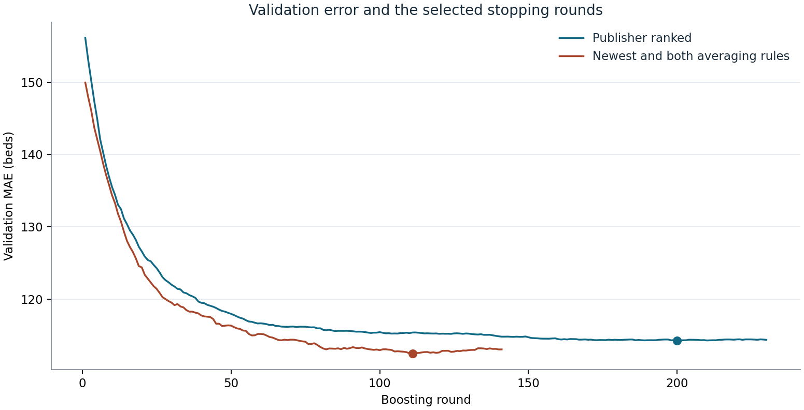
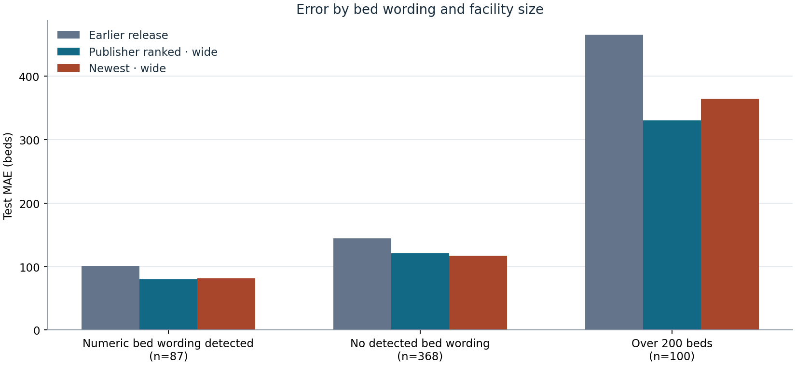

# Capacity model comparison after description recovery

**The newest-report rule and the two date-window averages tied for lowest error.** Each scored **112.49 beds MAE on validation** and **110.22 on the same 455 test facilities**. Publisher ranking scored **114.33** and **112.96**, respectively. The newest rule is the simplest representative of the tied configurations on this snapshot. Its 2.73-bed test advantage over ranking had a paired 95% interval that includes zero. Publisher ranking had lower RMSE and lower error on facilities over 200 beds. The comparison produced evaluation artifacts only. [W&B run](https://forge.coreweave.com/wandb/yod347-carnegie-mellon-university/datathon-f26/runs/b0360372)

## 1. Apply source rules and recover missing fields

The archived input has 10,073 canonical facilities supplied by the 10,088 source rows. The four saved cleaning variants use publisher ranking, the newest eligible report, the same-year mean, and the mean within two calendar years. The original priority of explicit reviews, source eligibility, and branch-identity holds was applied in each variant. The publisher-ranked order is FDR, IFFCO and SBI for this snapshot. The same-year and two-year variants yielded the same selected numbers as newest because their eligible dated claims yielded no multi-publisher average. [Source-rule definitions and evidence](RULE_CLEANING_COMPARISON.md#3-compare-four-deterministic-source-rules)

Before fitting, we scanned **9,585 nonempty descriptions** attached to routable facilities, retaining the source-row index, exact excerpt, source URL when available, and explicit observation date when present. Each rule got the same parser. The description supplies a candidate when that rule still has a blank. Accepted publisher-selected values and explicit holds retain priority. The parser looked for exact whole-facility bed and doctor counts, installed equipment, directly offered services and a branch-specific establishment year. Competing exact numeric claims go to a hold. Qualification, scope and date guards filter approximate totals, unit counts, past or planned capacity and numbers belonging to another facility. [Description recovery code](wide_description_recovery.py)

| Field tested | Additional populated facilities per rule | Outcome |
| --- | ---: | --- |
| Services | 13 | Source-reported service claims with excerpts and attribution |
| Beds | 0 | Both preliminary candidates failed the scope review |
| Doctors | 0 | No newly usable exact whole-facility total for a blank field |
| Equipment | 0 | No accepted candidate for a blank field |
| Establishment year | 0 | No accepted candidate for a blank field |

The 13 new service cells contain source-reported MRI, dialysis, NICU or blood-bank claims. Each excerpt was checked in its stored facility record. A source statement alone leaves current availability uncertain. The preliminary bed candidates were a 200-bed claim about an associated hospital and a 16-bed claim describing the original nursing home in 1911. The added scope guards rejected six capacity mentions across the scan, including both would-be fills. Synthetic checks confirmed that the parser accepts an exact whole-hospital count, excludes historical, third-party, unit and minimum-only counts, and holds conflicting exact values. The corrected fit retained the earlier vetted description-derived values already in the source-rule snapshots. It added **zero** capacity training labels. [Ranked field-recovery evidence](../../local/description-wide-v3/ranked-description-evidence.jsonl) · [Newest field-recovery evidence](../../local/description-wide-v3/newest-description-evidence.jsonl)

## 2. Build numeric inputs and fit each rule from scratch

Each arm used **67 inputs before encoding**. The input schema contains the 49 original columns remaining after setting capacity aside as the target and removing the description column, plus district, documented services, 15 NFHS indicators and district population. Publisher-selected doctor counts, official websites, establishment years and audited geography were applied where available. The two phone fields use listing status. Raw phone numbers stay outside the model. Fields such as identifiers and other source strings stayed represented. Some fields were constant or had no repeatable tokens, so the booster could only use variation where it existed. Training-only numeric conversion, one-hot encoding and TF-IDF produced **1,976 encoded inputs** for publisher ranking and the same width for the three date-based arms. Descriptions supplied structured recovery evidence only, and the full text and recovery excerpts stayed outside XGBoost. Other source text and identifiers may still correlate with reporting or expose information about capacity. [Fitting and input code](train_description_recovery.py) · [Ranked feature encodings](../../local/description-wide-v3/ranked-feature-encodings.json)

The fitter checked the frozen hashes, one loaded OpenMP runtime, facility partitions, and holdout labels. The original reported labels define the **212 validation**, **213 interval calibration**, and **455 test** cases used by each rule. An original validation record with a flagged source disagreement was withheld, leaving 212 of 213. The test set and calibration set match the prior 455- and 213-branch cohorts. Every rule fitted 1,608 source-published training labels. Accepted ranked or dated decisions remained eligible. Known bad targets, identity holds, unresolved fields and model-estimated targets stayed outside training. The same two depths and two objective scales gave four candidate fits per rule. Validation MAE set the objective, depth, and stopping round before test. The corrected end-to-end run took about 40 seconds on CPU. A previous completion attempt failed when writing its runtime receipt. Initializing the timer and repeating the frozen fit reproduced its scores and saved the full logs.



## 3. Evaluate the four treated datasets

| Source rule | Validation MAE | Test MAE | Test RMSE | Test median absolute error | Mean signed test error |
| --- | ---: | ---: | ---: | ---: | ---: |
| Publisher ranked | 114.33 | 112.96 | **251.30** | 41 | −35.25 |
| Newest report | **112.49** | **110.22** | 260.35 | **32** | −61.97 |
| Same-year mean | **112.49** | **110.22** | 260.35 | **32** | −61.97 |
| Two-year mean | **112.49** | **110.22** | 260.35 | **32** | −61.97 |
| Earlier publisher-ranked release | — | 136.44 | 316.89 | 42 | −91.41 |

Errors are in beds. MAE measures the typical absolute miss by averaging all misses equally. RMSE emphasizes large errors. Negative signed error indicates underprediction. The three date-based variants made identical predictions for every test facility. Their paired test MAE difference versus publisher ranking was **−2.73 beds** with a **95% interval of −8.92 to +2.94**. The comparison used 1,500 paired bootstraps across 212 test clusters. The lower test MAE supports calling the date-based runs the observed winners. The interval leaves room for either rule to be better on fresh facilities.

The newest model reduced test MAE by **26.21 beds** relative to the earlier release, with a paired interval of **15.72 to 38.00 beds of improvement**. This comparison changed the feature set, the cleaning inputs and the tuning sample. It cannot identify how much of the gain came from description parsing. The test facility IDs and reported labels match, and this is a reused historical holdout. A separate error check on independently verified facilities with newly observed counts would be needed to measure accuracy where capacity was genuinely missing. [Detailed metrics and training curves](../../local/description-wide-v3/metrics.json)



## 4. Check where the errors remain

On the 368 test facilities without detected numeric bed wording, the newest fit averaged **117.10 beds MAE** versus **120.80** for ranking and **144.69** for the earlier release. At the 100 facilities with more than 200 beds, newest averaged **364.55 beds MAE** and publisher ranking averaged **330.10**. Newest underestimated those larger facilities by **310.41 beds** on average. Its nominal 90% interval covered **89.9%** of reported test counts, with a median width of **353 beds**. These limitations matter for using bed estimates as a capacity proxy. The wording split is descriptive and uses a heuristic regex. It gives no guarantee that other input fields are free of related text or that the relevant hospitals will be equally hard to predict when counts are missing.



## 5. Reproduce and inspect

Run this from the repository root with the frozen local checkpoint and [experiment dependencies](../requirements.txt). On the Mac run, the launch set `DYLD_LIBRARY_PATH=/opt/homebrew/opt/libomp/lib`, `KMP_DUPLICATE_LIB_OK=FALSE`, and `OMP_NUM_THREADS=2`. The results retain local excerpt-level evidence, test predictions, feature encoding manifests, boosters and per-trial learning curves. W&B contains the aggregate results, recovery counts, charts, and this report. [Reporting and logging code](report_description_recovery.py) · [W&B run](https://forge.coreweave.com/wandb/yod347-carnegie-mellon-university/datathon-f26/runs/b0360372)

```sh
capacity=max-supplemented-data/experiments/capacity
archive=max-supplemented-data/local/rule-cleaning-v2
run=max-supplemented-data/local/description-wide-replay
python "$capacity/train_description_recovery.py" --archive "$archive" --output "$run" --as-of 2026-11-22
python "$capacity/report_description_recovery.py" --results "$run/metrics.json" --plots "$run/plots"
```
