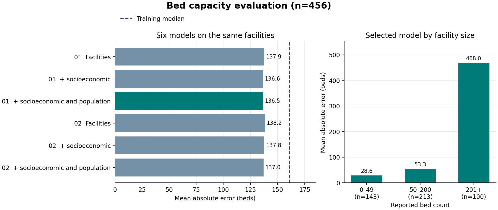

# Capacity prediction results

**Provisional.** This comparison and its local export were created before the user's In The Loop review. The W&B runs record the provisional experiment. Human decisions and the subsequent rerun are pending.

Iteration 01 with facility, socioeconomic and district population features had the lowest test mean absolute error, **136.49 beds** on 456 facilities. The median baseline's error was 160.78 beds. All six XGBoost models improved on the median baseline, and their errors were within 1.69 beds of each other. The selected model filled 6,829 eligible missing branch counts. [Aggregate metrics and tuning choices](https://forge.coreweave.com/wandb/yod347-carnegie-mellon-university/datathon-f26/runs/ei54n4wf) · [Local six-dataset receipt](../../local/capacity-comparison-v2/datasets/dataset_receipt.json)

## What we compared

- We started from the 10,088-row Virtue Foundation snapshot and the two separately frozen source-selection iterations. Four unlinked rows stayed outside modeling, and 11 duplicate source rows were collapsed when fitting, leaving 10,073 branches. The final export retains every original row. Each arm uses its own iteration's filled doctor-count predictors across all splits and its own selected capacity labels for training. The targets in validation, interval calibration and test all use original reported counts.
- The source-selector audit deliberately focused on conflicting claims. We used that evidence to exclude all 10 independent browser-review branches from capacity fitting. Six of them were in training, three were in the original calibration partition, and one was in test. The latter four already failed the evaluation filters. The final rerun uses the same 456 facility IDs and original targets as the preliminary run. Earlier source reviews and conflicting counts are excluded from the common evaluation, and older eligible reviewed values may contribute to training. [Browser audit](../verification/README.md)
- We tried the two source-selection iterations with three feature tiers each. The facility tier uses filled doctor counts, audited coordinates, organization categories, and structured web and social metadata. The socioeconomic tier adds NFHS-5 district indicators. The third tier also adds log district population. Text that can directly state beds and counts generated by other prediction models are excluded. Phone numbers and phone availability stay in the contact workflow. Numeric nulls go through XGBoost's missing-value handling. Categorical values use training-only one-hot levels and a missing indicator. [Feature assembly](prepare_data.py) · [Training code](train_evaluate.py)
- The NFHS join uses the audited state and district pair. Of 456 test rows, 276 have NFHS predictors and 273 have population. All 456 contribute to every score. The GitHub CSV had 706 population rows, 679 with values. The user confirmed that its row order follows NFHS. We checked the district sequence against the cached raw NFHS response and saved a keyed join receipt. This column contains district population. Population density requires area. Several Arunachal Pradesh spot checks differ substantially from 2011 Census counts, so the vintage, geography and linkage warrant further confirmation. [Population input revision](https://github.com/augustchu/datathon-F26/blob/d6bb601d61882d8f42e200793cd11d629a9f7fe0/data/population/nfhs_population_only.csv) · [Arunachal Pradesh Statistical Abstract 2023](https://ecostatistics.arunachal.gov.in/vali_admin/images/state_publication/347899FINAL%20-Statitistical%20Abstract%202023-compressed.pdf)
- A previous review caught a 200,000-bed label for Harsh Hospital in Purnea. The operator distinguishes a patient volume figure of 200,000+ from a bed count given as 50+. We excluded the defective label and carry its original value and public evidence in the audit. The final capacity for that branch is blank because the bed count is a lower bound. [Operator site](https://harshhospital.com/)

## Test design and metrics

Iteration 01 supplied 1,616 usable training targets, and iteration 02 supplied 1,613. Both had 1,287 original reported values, 204 dated external values and eight counts recovered from original descriptions. Iteration 01 had 113 contested original values and four direct reviews. Iteration 02 had 108 contested originals and six direct reviews. Those training labels retain their provenance. The 426 eligible branches in the original calibration split were deterministically divided into 213 for tuning and 213 for intervals. The 456 test branches stayed outside both steps.

Each model compared raw absolute-error training with squared-error training on `log1p(beds)`, at depths 3 and 5. The four trials used the same rounds, stopping policy and seed. Selection within each experiment used validation MAE after converting predictions back to whole beds. All six selected log-scale training. The median baseline predicts the median of the arm's training labels, 75 beds for each arm.

MAE measures the average absolute miss in beds. Median absolute error shows the typical miss, and the 90th percentile shows the error threshold that 90% of test facilities were within. RMSE gives more weight to large misses. Signed bias is predicted minus reported beds. R² describes how much variation the model explains on the held-out sample and can be negative. We computed paired differences using 1,500 bootstrap samples from 213 district or single-facility groups. Prediction intervals use the held-out calibration residuals and a nominal 90% coverage target.

| Supplement | Feature tier | Validation MAE | Test MAE | Median error | 90th pctl error | RMSE | R² | Bias | Interval coverage |
| --- | --- | ---: | ---: | ---: | ---: | ---: | ---: | ---: | ---: |
| 01 | Facilities | 129.67 | 137.87 | 41.0 | 380.0 | 317.55 | 0.153 | −88.84 | 90.1% |
| 01 | Facilities + socioeconomic | 130.14 | 136.59 | 39.5 | 389.5 | 321.22 | 0.134 | −92.84 | 89.7% |
| **01** | **Facilities + socioeconomic + population** | **132.10** | **136.49** | **41.0** | **377.0** | **322.13** | **0.129** | **−91.97** | **89.5%** |
| 02 | Facilities | 131.37 | 138.18 | 40.0 | 385.5 | 322.52 | 0.127 | −95.68 | 89.9% |
| 02 | Facilities + socioeconomic | 131.62 | 137.79 | 39.0 | 388.5 | 324.16 | 0.118 | −95.88 | 89.7% |
| 02 | Facilities + socioeconomic + population | 130.85 | 137.05 | 39.5 | 369.0 | 322.42 | 0.127 | −94.62 | 90.1% |
| Both | Training median | — | 160.78 | 50.0 | 437.5 | 366.18 | −0.126 | −122.41 | — |

## Where it worked and where it missed

| Supplement and tier | 0–49 beds, n=143 | 50–200 beds, n=213 | 201+ beds, n=100 |
| --- | ---: | ---: | ---: |
| 01 facilities | 30.71 | 56.77 | 463.86 |
| 01 socioeconomic | 29.31 | 51.55 | 471.13 |
| 01 socioeconomic + population | 28.62 | 53.28 | 468.01 |
| 02 facilities | 30.52 | 50.94 | 477.97 |
| 02 socioeconomic | 29.54 | 50.36 | 478.84 |
| 02 socioeconomic + population | 29.83 | 50.56 | 474.60 |

The table shows MAE in beds. The selected model underpredicted the 201+ group by 449 beds on average. It was 125 beds off on average when a filled doctor count was present, and 151 beds off when it was missing. Among state groups with at least 15 test branches, it had its smallest MAE in Gujarat (61.29, n=31) and its largest in Uttar Pradesh (249.97, n=32). Facility mix, label quality and missingness differ across these groups. Each arm's full state, district familiarity, and feature-coverage breakdown is in the aggregate metrics. The selected model's median interval is 432 beds wide. The measured coverage applies to facilities with reported counts on this test and may shift on genuinely missing records.

## Why we used this model

The reporting rule selected the lowest test MAE. The selected model beat the median by **24.29 beds** with a paired 95% interval of **16.31 to 32.88 beds** of improvement. The facility-only iteration 01 model led validation and had the best test RMSE. Adding population in iteration 01 lowered MAE by only **0.10 beds** relative to the matching socioeconomic model, with a paired 95% interval for the change of **−2.79 to +2.64 beds**. Every planned feature-tier or iteration comparison included zero. The held-out data support an improvement over the median and leave the enrichment advantage uncertain.

The preliminary run favored iteration 02 with socioeconomic features before the independent browser-review branches were withheld from training. The final run changed which arm came first on the same test set. That sensitivity and the split between the validation and test winners matter more than the small lead. Using test MAE to choose the release model makes 136.49 an observed selection result. A fresh labeled evaluation would be needed to estimate the chosen model's performance independently. Neither selector earned priority over its publisher fallback. [Source selector comparison](../source_selection/README.md)

## Final export contract

The standalone iteration 01 export preserves **10,088 original rows**. It adds **6,829 distinct branch estimates**, which appear on 6,833 original rows after repeated links are restored. At the original-row level there are 2,727 documented values, 6,833 estimates and 528 blanks. Blanks include 503 branch identity holds, 12 earlier unresolved reviews, 12 other missing values and the one defective target hold. The flat CSV carries `capacity_status`, `capacity_source`, `capacity_source_url` and explicit prediction interval and model columns. In JSONL, `original` and `count_fields.capacity` preserve prior provenance. `final_capacity` holds the release value, its method and, for estimates, the fitted model and interval.

The export for this earlier run is local and separate from the team's load-balancing pipeline. It estimates facility scale. Current occupancy, staffed beds today and service availability need their own evidence. [Newest-source release](NEWEST_CAPACITY_RELEASE.md)
