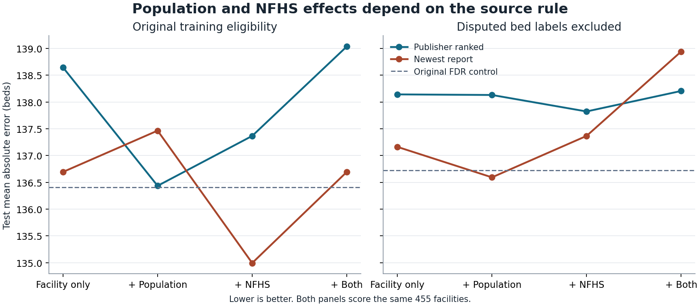
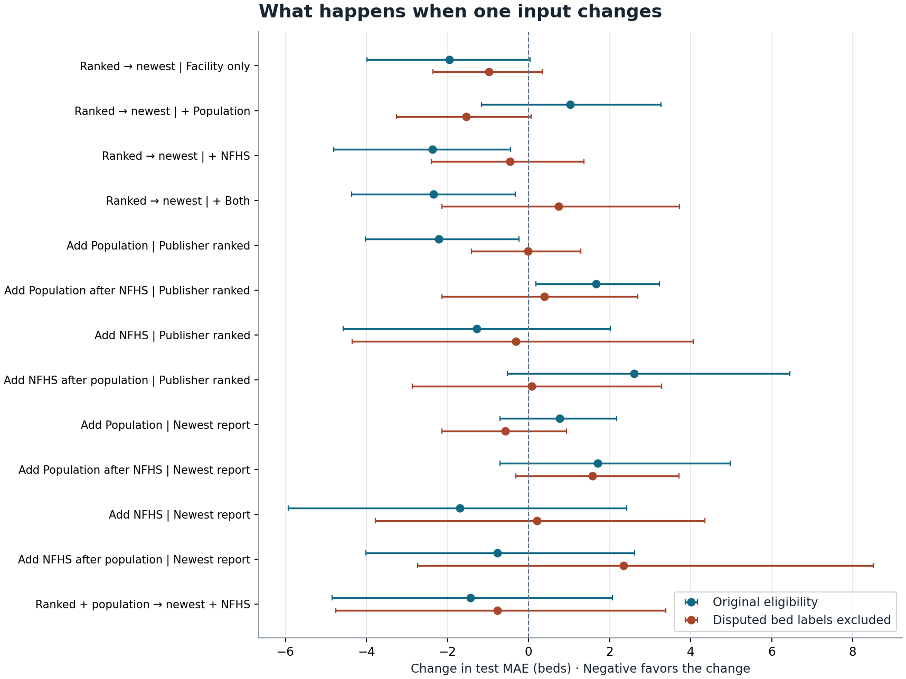
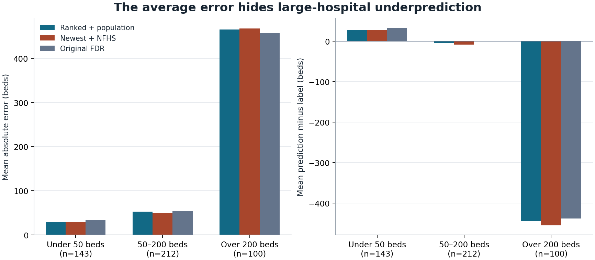

# Which source rules and district features predict bed capacity best?

**Keep publisher ranking plus district population for the current release.** It won the original validation protocol at **129.09 beds MAE**, and the fresh fit reproduced the released model’s predictions. Publisher ranking also led validation after removing source-disputed bed counts, but its best feature block changed to NFHS. The lowest test MAE changed from **newest + NFHS (134.99 beds)** to **newest + population (136.59 beds)** under the stricter policy. No district feature block won consistently enough to justify a release change. [Prior release decision](CAPACITY_MODEL_DECISION.md) · [W&B run](https://forge.coreweave.com/wandb/yod347-carnegie-mellon-university/datathon-f26/runs/39516c15)

## Fresh run and checks

1. **Verify the input and CPU runtime.** The facility snapshot and schema matched their frozen hashes. The 10,073 canonical IDs were unique. The code verified that no fit rows overlapped the validation, interval-calibration, or test partition, that there were no known target defects or routing holds in fitting, and that evaluation labels came from original reported counts outside the review-exposed set. XGBoost and scikit-learn could load separate OpenMP libraries on this Mac. The run pinned a single installed runtime, disabled scikit-learn’s duplicate-library override, and passed a three-round CPU booster smoke test before any experimental fit.
2. **Refit every arm.** Each arm started without a saved model and independently tuned the same four XGBoost configurations using validation MAE. The four source rules and four feature sets gave 16 supplemented arms plus an original FDR control per pass. That produced 34 fresh fitted arms in 20.73 seconds including paired analysis. On both passes the same-year mean, two-year mean, and newest-report policies produced identical test predictions. The tables show the newest-report representative. Population is a district population total. NFHS supplies a separate district socioeconomic feature block. Each district block is added to a common facility feature base.
3. **Inspect the effect of source disagreements.** The original-eligibility pass reproduced the earlier predictions byte for byte. The stricter pass turned off eligibility for 146 training rows flagged for bed-count disagreements. That removed 131 usable training labels per supplemented arm, from 1,608 to 1,477, and 130 labels from the FDR control, from 1,417 to 1,287. Fifteen of the held rows had no selected bed label for the supplemented fits already. A further source disagreement was found on the 213-row validation cohort and excluded in the stricter pass without reshuffling the other 212 rows. The calibration cohort stayed at 213 and the test set at 455. These flags pertain to the bed target and cannot establish independent verification of every doctor-count predictor.
4. **Pair the comparisons on the same test facilities.** Every arm predicted the same 455 facilities with identical reported labels. Each effect below subtracts the two absolute errors at each facility. The interval uses 1,500 paired bootstraps over 212 district clusters, with a unique group for a branch when its district is unavailable. These are exploratory, unadjusted 95% intervals. The test set has been used previously, and 397 test branches share a district with an eligible training branch. Conclusions apply to these historical cohorts. [Source and feature experiment code](source_feature_factorial.py) · [Full aggregate results](../../local/rule-factorial-v1/aggregate-results.json)

## Test MAE across all feature combinations

| Training eligibility | Source rule | Facility only | + Population | + NFHS | + Both |
| --- | --- | ---: | ---: | ---: | ---: |
| Original | Publisher ranked | 138.65 | **136.44** | 137.37 | 139.04 |
| Original | Newest report | 136.69 | 137.47 | **134.99** | 136.69 |
| Original | Original FDR control | 136.41 | — | — | — |
| Source-disputed beds excluded | Publisher ranked | 138.14 | 138.13 | **137.82** | 138.21 |
| Source-disputed beds excluded | Newest report | 137.16 | **136.59** | 137.37 | 138.94 |
| Source-disputed beds excluded | Original FDR control | 136.72 | — | — | — |



## Changing one factor at a time

- **Source rule only.** With NFHS fixed, switching from ranking to the newest report reduced test MAE by **2.37 beds** in the original pass (paired 95% interval −4.82 to −0.44). With population fixed, the same switch increased MAE by **1.03 beds** (−1.16 to +3.27). Excluding disputed beds reduced the NFHS advantage to **0.46 beds** (−2.40 to +1.37), while the population comparison reversed in favor of newest by **1.54 beds** (−3.26 to +0.06).
- **Population only.** Starting from ranked facility-only data, adding population reduced test MAE by **2.21 beds** (−4.03 to −0.23) in the original pass. That gain fell to **0.01 beds** (−1.40 to +1.29) after excluding disputed beds. Adding population to the original newest + NFHS model worsened point MAE from 134.99 to 136.69 beds.
- **NFHS only.** Adding NFHS to the newest-report facility-only model lowered original-pass MAE by **1.70 beds** (−5.94 to +2.42), and increased strict-pass MAE by **0.20 beds** (−3.79 to +4.35). Adding NFHS to ranked + population increased point MAE by 2.60 beds in the original pass and by 0.07 beds in the strict pass.
- **Both feature blocks, or both decisions.** Including both district blocks produced higher test MAE than the better single district block in all four rule-by-eligibility cases. Switching from ranked + population to newest + NFHS changed both the rule and the feature block. It reduced MAE by **1.44 beds** (−4.85 to +2.07) with original eligibility and **0.76 beds** (−4.76 to +3.39) after excluding disputed beds.



## Decision and limitations

For the current package, keep the preselected ranked + population fit. In the stricter analysis the **validation** winner was **ranked + NFHS** at 130.58 beds, with 137.82 beds on test. If the task is to train with every flagged bed disagreement withheld, ranked + NFHS is the choice under the same validation criterion. That configuration’s test MAE was higher than the stricter FDR control’s 136.72 beds. The two newest-source configurations had the lowest observed test MAE under their respective policies. Their gains against the original-data control were small, and their rank was sensitive to which labels were eligible for fitting.

NFHS was available for 275 test facilities and population for 272. There were 272 with both and 183 missing one or both, all of whom stayed in the comparison. The 100 hospitals with more than 200 beds had average errors above 450 beds for each of the three original-pass models plotted below. They were substantially underpredicted. The error on this group and the small differences between configurations matter more for deployment than the ordering of a few test MAE points. A new, independently reviewed cohort could adjudicate whether the validation-selected or test-leading configurations generalize. [Earlier release limitations and handoff](RULE_CLEANING_COMPARISON.md#5-workbook-verification-and-pipeline-handoff)



## Replay and tracking

Run from the repository root with the frozen local checkpoint and the [experiment dependencies](../requirements.txt). On this Mac, the launch set `DYLD_LIBRARY_PATH=/opt/homebrew/opt/libomp/lib`, `KMP_DUPLICATE_LIB_OK=FALSE`, and `OMP_NUM_THREADS=2`. The crucial runtime checks are in the driver. Use a fresh output directory and a fresh plot path for each replay.

```sh
capacity=max-supplemented-data/experiments/capacity
archive=max-supplemented-data/local/rule-cleaning-v2
run=max-supplemented-data/local/rule-factorial-replay
python "$capacity/source_feature_factorial.py" --archive "$archive" --output "$run"
python "$capacity/plot_source_feature_factorial.py" \
  --results "$run/aggregate-results.json" --output "$run/plots"
```

The W&B run contains three figures, native charts for the source-rule switch and validation-to-test changes, the complete fitted-arm score table, and a filterable table of every paired comparison. The logger uploads aggregate metrics, figures and this report. [W&B run](https://forge.coreweave.com/wandb/yod347-carnegie-mellon-university/datathon-f26/runs/39516c15) · [Plot builder](plot_source_feature_factorial.py) · [W&B logger](log_source_feature_factorial.py)
